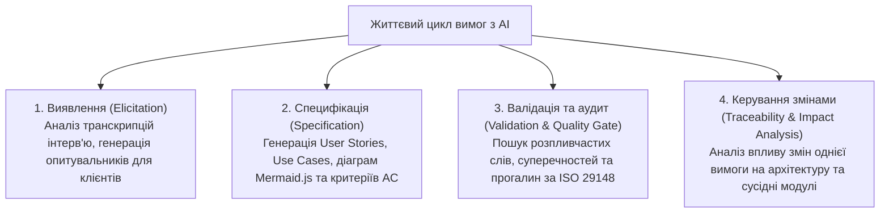

# Урок 171: Використання AI для підготовки та перевірки вимог

## Вступ: Нова ера AI-Augmented Business Analysis

Професія бізнес-аналітика переживає фундаментальну трансформацію. Рутинні механічні завдання — транскрибування багатогодинних інтерв'ю зі стейкхолдерами, переписування тез у шаблонні User Stories, форматування BDD-критеріїв та пошук пропущених ком у специфікаціях — дедалі більше делегуються генеративним моделям штучного інтелекту.

Проте штучний інтелект не замінює бізнес-аналітика, а наділяє його «суперсилами». Звільнившись від рутини, аналітик фокусується на стратегічних речах: виявленні прихованих потреб бізнесу, фасилітації складних переговорів між конфліктуючими стейкхолдерами, валідації продуктових гіпотез та критичному рев'ю рішень. AI стає інтелектуальним партнером (Analysis Copilot), який допомагає готувати, декомпозувати та піддавати безжальному аудиту будь-які вимоги до старту розробки.

---

## 1. Сфери застосування AI на всіх етапах життєвого циклу вимог

Генеративні мовні моделі застосовуються на чотирьох ключових фазах роботи з вимогами за методологією BABOK v3:



1. **Екстракція вимог із неструктурованих інтерв'ю**:
   - Завантаження сирої стенограми 60-хвилинної розмови з клієнтом із промптом: «Виділи ключові болі (Pain Points), функціональні побажання та нефункціональні обмеження у вигляді структурованого списку».
2. **Генерація артефактів за стандартами**:
   - Швидке перетворення чорнових заміток у формат Gherkin (Given-When-Then), побудова матриць NFR за моделлю FURPS+ або генерація валідних діаграм процесів у Mermaid.js (Sequence, Flowchart, State).
3. **Автоматизований аудит якості (Requirements Linter)**:
   - Перевірка тексту ТЗ за стандартом ISO 29148 на предмет відсутності заборонених слів («швидко», «зручно»), оцінка тестованості та повноти.

---

## 2. Промпт-інжиніринг для бізнес-аналітика: Архітектура системних промптів

Ефективність AI у бізнес-аналізі залежить від надання повного бізнес-контексту та встановлення чітких методологічних обмежень.

### Золотий шаблон промпту для аналізу вимог:

```text
[РОЛЬ І ЕКСПЕРТИЗА]
Дій як Lead Business Analyst & Enterprise Architect з 15-річним досвідом за стандартами BABOK v3 та ISO/IEC/IEEE 29148.

[КОНТЕКСТ ПРОЄКТУ]
Проєкт: Хмарна B2B платформа для автоматизації закупівель медичного обладнання.
Цільова аудиторія: Головні лікарі лікарень та сертифіковані постачальники.

[ВХІДНІ ДАНІ]
Ось опис нової бізнес-ініціативи:
[Вставити текст від стейкхолдера]

[ЗАВДАННЯ]
1. Сформулюй 3 User Stories за стандартом INVEST.
2. Для кожної історії розпиши 3 BDD критерії приймання (Given-When-Then), включаючи 1 обов'язковий негативний крайовий випадок.
3. Визнач 2 специфічні NFR (Security та Performance).

[ОБМЕЖЕННЯ]
- Заборонено використовувати суб'єктивні слова ('швидко', 'зручно', 'інтуїтивно').
- Усі числові параметри повинні мати одиниці вимірювання.
- Стиль: діловий, лаконічний, структурований Markdown.
```

---

## 3. Виявлення галюцинацій та критичний аналіз згенерованих вимог

Головна небезпека використання AI — сліпа довіра до його текстів. Мовні моделі можуть створювати текст, який виглядає надзвичайно професійно, але містить критичні дефекти:
- **Фабрикація неіснуючих бізнес-правил**: AI може додати вимогу про обов'язкове списання податку 18%, якого не існує в юрисдикції вашого замовника.
- **Архітектурна наївність**: Модель може згенерувати вимогу, яка є технічно нездійсненною на поточному стеку або вимагає мільйонних витрат на інфраструктуру.
- **Пропуск галузевих стандартів**: Якщо в промпті явно не вказано стандарти регулятора (наприклад, вимоги НБУ до банківських додатків або норми GDPR), AI проігнорує їх.

### Чеклист аналітика для перевірки згенерованого AI артефакту:
- [ ] 1. Чи узгоджуються згенеровані правила з реальним законодавством країни замовника?
- [ ] 2. Чи відповідає запропонована логіка бюджету та строкам команди розробки?
- [ ] 3. Чи немає в тексті прихованих припущень, які не були узгоджені з Product Owner?
- [ ] 4. Чи здатна команда тестування однозначно перевірити кожен сформульований критерій?

---

## 4. Етичні та безпекові обмеження: Захист комерційної таємниці

При використанні штучного інтелекту в корпоративному бізнес-аналізі діють суворі правила кібербезпеки:
1. **Заборона завантаження сирих комерційних даних (Non-Disclosure Agreement / NDA)**: Заборонено передавати в публічні версії ChatGPT назви компаній-клієнтів, реальні фінансові звіти, бази даних клієнтів або закриті юридичні договори.
2. **Анонімізація даних (Data Sanitization)**: Перед відправкою в AI текст обов'язково очищається від персональних даних (PII), реальних імен та назв проєктів (використання псевдонімів: *«Компанія Х»*, *«Банк Y»*).
3. **Використання Enterprise AI моделей**: Робота виключно через корпоративні API з гарантією відсутності навчання публічних моделей на даних вашої компанії (Zero Data Retention Policy).


## Практичний інженерний розбір: Повна специфікація вимог для платіжного модуля

Розглянемо реальний зразок детальної специфікації вимог, що поєднує User Story, Acceptance Criteria за Gherkin та Use Case:

### 1. User Story та Acceptance Criteria:
```gherkin
Feature: Збереження платіжної картки
  Як зареєстрований покупець,
  Я хочу зберегти картку для оплати в один клік,
  Щоб не вводити реквізити при наступних покупках.

  Scenario: Успішна токенізація картки
    Given Користувач на екрані оплати
    When Вводить валідні PAN, EXP, CVV та відмічає "Зберегти картку"
    And Натискає "Оплатити"
    Then Платіжний шлюз повертає токен
    And Система зберігає маскований токен "•••• 4242" у профілі
```


## Комплексний фреймворк аналізу вимог: Від бізнес-мети до детальної специфікації

Бізнес-аналітик виступає архітектором рішень, транслюючи абстрактні очікування бізнесу у чіткі, несуперечливі та тестовані функціональні специфікації:

```
[Стратегічні цілі бізнесу (Business Goals)]
                     │
                     ▼
[Класифікація вимог: Functional (FR) vs Non-Functional (NFR)]
                     │
                     ▼
[Декомпозиція на рівень користувача: User Stories (INVEST) та Use Cases]
                     │
                     ▼
[Формалізація критеріїв приймання: Acceptance Criteria (Given-When-Then)]
                     │
                     ▼
[Опис сценаріїв взаємодії: Main Success Scenario, Alternative, Exception]
                     │
                     ▼
[Валідація та верифікація за допомогою AI: усунення прогалин і двозначностей]
```

### Порівняльна матриця артефактів вимог: User Story проти Use Case

| Критерій | User Story (Agile підхід) | Use Case (Системний підхід) |
| :--- | :--- | :--- |
| **Головна мета** | Зафіксувати бізнес-цінність та створити основу для бесіди | Описати повну детальну поведінку системи крок за кроком |
| **Формат запису** | «Як [роль], я хочу [дію], щоб [цінність]» | Передумови, основний потік подій, альтернативи, післяумови |
| **Рівень деталізації**| Короткий, лаконічний (доповнюється Acceptance Criteria)| Високий, вичерпний, описує технічні реакції системи |
| **Для кого призначений**| Команда розробки, Product Owner, стейкхолдери | Інженери, архітектори, QA інженери для побудови тестів |
| **Критерій якості** | Відповідність стандарту INVEST (Independent, Valuable...)| Повнота покриття всіх помилкових та крайових гілок |


## Системна інженерія вимог та моделювання бізнес-процесів (BPMN & UML)

Точність опису бізнес-вимог визначає архітектурну якість майбутнього програмного продукту:

### 1. Нотації візуалізації процесів:
- **BPMN 2.0 (Business Process Model and Notation)**: Стандарт моделювання бізнес-процесів із використанням басейнів (Pools), доріжок (Lanes), подій (Events), шлюзів (Gateways) та активностей (Tasks).
- **UML Use Case Diagrams**: Візуалізація меж системи, взаємодії акторів та зв'язків `<<include>>` (обов'язкове включення підсценарію) та `<<extend>>` (умовне розширення).

### 2. Управління ризиками вимог та запобігання Scope Creep:
- **Scope Creep (Розповзання меж проєкту)**: Неконтрольоване зростання вимог без коригування бюджету та термінів.
- **Change Request Management**: Формальний процес оцінки вартості, ризиків та доцільності кожної нової зміни перед її включенням у беклог.
- **Definition of Ready (DoR)**: Узгоджений чеклист, якому повинна відповідати вимога до передачі на оцінку розробникам.


## Стандарти верифікації та валідації бізнес-вимог (Requirements Quality Gate)

Специфікація вимог вважається готовою до передачі в розробку (Definition of Ready) лише за виконання критеріїв:

### 1. Модель INVEST для User Stories:
- **Independent**: Ізольована від інших історій, де це можливо.
- **Negotiable**: Відкрита для обговорення технічних деталей реалізації.
- **Valuable**: Несе чітку бізнес-цінність для кінцевого користувача.
- **Estimable**: Може бути оцінена командою розробки у Story Points.
- **Small**: Може бути повністю завершена в межах одного спринта.
- **Testable**: Має однозначні критерії приймання (Pass/Fail).

### 2. Чеклист перевірки специфікації вимог:
- [ ] Описано як позитивні, так і всі негативні сценарії поведінки системи
- [ ] Зафіксовано конкретні числові метрики продуктивності та безпеки (NFR)
- [ ] Усунено суперечності між вимогами різних стейкхолдерів


## Практичний AI-Playbook бізнес-аналітика: Формалізація вимог та User Stories

Шаблони для генерації критеріїв приймання та Use Cases за бізнес-описом:

### Промпт для трансформації сирої вимоги у строгу специфікацію:
```text
Дій як Lead Business Analyst. Ось сирий опис бізнес-потреби від стейкхолдера:
[Вставити текст бізнес-вимоги]
Трансформуй цю вимогу у повноцінний інженерний артефакт:
1. Сформулюй User Story за стандартом «Як [роль], я хочу [дію], щоб [цінність]».
2. Напиши вичерпний список Acceptance Criteria у форматі Gherkin (Given-When-Then), включаючи позитивні, альтернативні та помилкові сценарії.
3. Визнач критичні нефункціональні вимоги (NFR): продуктивність, безпека, доступність.
4. Перевір отриманий артефакт за критеріями якості INVEST.
```


## Архітектурний шаблон enterprise-рівня: Наскрізна матриця трасування вимог (RTM)

Управління змінами вимог у масштабних регульованих проектах (Fintech, MedTech, GovTech):

### 1. Архітектура трасування (End-to-End Traceability):
- Зв'язок: Бізнес-мета -> Епік -> User Story -> Acceptance Criteria -> Тест-кейс -> Код Pull Request.
- Аналіз впливу змін (Impact Analysis): якщо бізнес-вимога змінюється, система автоматично виявляє всі тести та модулі коду, які потребують оновлення.
- Захист від втрати вимог під час розробки (No Lost Scope).

### 2. Матриця готовності бізнес-аналізу до релізу:
- **Повнота покриття критеріями приймання**: 100% User Stories мають чіткі сценарії Pass/Fail.
- **Узгодженість зі стейкхолдерами**: Формальне підтвердження всіма зацікавленими сторонами.
- **Відсутність блокуючих ризиків**: Ідентифіковані та узгоджені плани реагування на нефункціональні ризики.


## Інженерна матриця валідації бізнес-моделей та управління ризиками проєкту

Робота бізнес-аналітика лежить в основі окупності інвестицій у розробку програмного продукту:

### 1. Управління ризиками за методологією BABOK v3
- **Ідентифікація та категоризація ризиків**: Бізнесові, технічні, операційні, фінансові та регуляторні ризики.
- **Оцінка ймовірності та впливу (Probability & Impact Matrix)**: Формування плану пом'якшення ризиків (Risk Mitigation Plan) для кожної критичної вимоги.
- **Cost of Delay (Вартість затримки)**: Розрахунок економічних втрат компанії у разі відтермінування запуску фічі на ринок, що визначає пріоритет за моделлю WSJF (Weighted Shortest Job First).

### 2. Чеклист аудиту якості специфікації вимог:
- [ ] Вимоги пройшли формальне погодження з усіма ключовими стейкхолдерами
- [ ] Відсутність суперечностей між бізнес-цілями та технічними обмеженнями архітектури
- [ ] Кожна вимога пов'язана з конкретними бізнес-метриками успіху (KPI / OKR)
- [ ] Описано критерії відкату та план дій на випадок аварійної деградації функціоналу


## Поглиблена інженерна практика: Моделювання бізнес-процесів BPMN 2.0 та керування змінами

Створення масштабованих бізнес-рішень вимагає точного графічного моделювання та системного контролю за змінами вимог:

### 1. Нотація BPMN 2.0 у практиці бізнес-аналітика
Стандартизований опис бізнес-процесів компанії:
- **Басейни та доріжки (Pools & Lanes)**: Чіткий розподіл зон відповідальності між учасниками процесу (Клієнт, Менеджер, Платіжний шлюз, Система обліку).
- **Події та шлюзи (Events & Gateways)**: Моделювання паралельних (AND), ексклюзивних (XOR) та інклюзивних (OR) розвилок у логіці виконання процесів.
- **Інженерна цінність BPMN**: Моделі процесів можуть безпосередньо транслюватися в рушії виконання бізнес-процесів (Camunda, Temporal).

### 2. Управління змінами (Change Request Management)
Коли бізнес вимагає нових фіч посеред спринту:
- **Аналіз впливу (Impact Analysis)**: Оцінка змін у масштабі часу, бюджету, архітектури та ризиків за трикутником проєктного менеджменту.
- **Формалізація запиту на зміну (Change Request)**: Фіксація причин зміни, пропонованого рішення та погодження додаткових ресурсів зі спонсором проєкту.
- **Підтримка актуальності беклогу**: Регулярний грумінг (Backlog Refinement) для підтримки пріоритетів відповідно до поточної стратегії компанії.


## Інженерний інструментарій аналізу вимог (Business Analysis Toolkit)

Системний бізнес-аналіз спирається на надійні цифрові інструменти моделювання:
- **Візуалізація та картографування процесів**: Miro, Lucidchart, Whimsical для спільного фасилітування воркшопів із клієнтами та побудови User Story Maps.
- **Формальне моделювання архітектури (Camunda Modeler, Draw.io)**: Побудова валідних схем BPMN 2.0 та UML-діаграм прецедентів з можливістю експорту XML для рушіїв автоматизації.
- **Управління портфелем вимог (Jira Product Discovery, Confluence)**: Ведення наскрізних матриць пріоритетів, відстеження гіпотез та автоматичне оновлення продуктової документації.


## Комплексний інженерний чеклист валідації вимог (Requirements Quality Gate)

Перед затвердженням специфікації вимог та стартом розробки функціоналу:
1. **Чіткість та однозначність**:
   - [ ] Кожна User Story відповідає критеріям INVEST (Independent, Negotiable, Valuable, Estimable, Small, Testable).
   - [ ] Критерії приймання сформульовані за форматом Given-When-Then, усунуто неоднозначні терміни ("швидко", "зручно").
2. **Повнота сценаріїв**:
   - [ ] Описано щасливий шлях (Happy Path), альтернативні гілки та сценарії обробки бізнес-помилок і збоїв систем.
   - [ ] Зафіксовано нефункціональні вимоги: очікуваний час відповіді API, вимоги до доступності та навантаження.
3. **Трасування та узгодження**:
   - [ ] Встановлено чіткий зв'язок між бізнес-метою компанії та конкретною функціональною вимогою.
   - [ ] Документ пройшов формальне рецензування розробниками, тестувальниками та бізнес-стейкхолдерами.


## Практичний інженерний кейс-стаді: Декомпозиція та узгодження масштабного регуляторного епіку

Розглянемо практичний досвід бізнес-аналітика з впровадження вимог європейського регламенту захисту персональних даних (GDPR):
1. **Вихідний виклик**: Юридичний відділ надав абстрактну вимогу: «Система повинна повністю підтримувати право користувача на забуття (Right to be Forgotten) та експорт даних (Data Portability)». Розробники відмовлялися брати задачу в спринт через відсутність технічної конкретики.
2. **Робота бізнес-аналітика**:
   - Проведено серію воркшопів із Data Privacy Officer та системними архітекторами.
   - Складено наскрізну карту потоків персональних даних (Data Flow Diagram), що виявила 14 баз даних, логів та сторонніх сервісів аналітики, де зберігаються персональні дані клієнта.
   - Сформовано набір із 12 структурованих User Stories за стандартом INVEST із чіткими критеріями приймання Given-When-Then.
   - Спроєктовано асинхронний сценарій: формування архівованого ZIP-файлу з даними користувача протягом 24 годин із захищеним посиланням, дійсним 48 годин.
   - Результат: Функціонал успішно розроблено та протестовано за 2 спринти без затримок та регуляторних штрафів.


## Метрики якості управління вимогами та інженерна ефективність беклогу

Професіоналізм бізнес-аналітика безпосередньо впливає на стабільність та швидкість поставки фіч командою:
1. **Метрики стабільності обсягу (Scope Stability)**:
   - **Requirements Volatility Index (RVI)**: Відсоток вимог, що зазнали суттєвих змін після старту спринту або фази активної розробки (цільовий рівень — < 5%).
   - **Defect Removal Efficiency (DRE)**: Частка дефектів у вимогах, виявлених на етапі рев'ю специфікації до потрапляння в код розробників (цільовий рівень — понад 90%).
2. **Метрики готовності та точності оцінок**:
   - **DoR Compliance**: 100% User Stories відповідають критеріям готовності Definition of Ready на момент планування спринту.
   - **Estimation Accuracy**: Відповідність запланованих Story Points фактично виконаним зусиллям команди.


## Інтеграція генеративного AI у бізнес-аналіз: Автоматизована генерація BDD та верифікація

Штучний інтелект виступає інтелектуальним партнером аналітика при підготовці беклогу:
1. **Синтез User Stories з бізнес-ідей**: Перетворення неструктурованих записів воркшопів у структуровані історії за стандартом INVEST.
2. **Генерація BDD Acceptance Criteria**: Автоматичне створення сценаріїв Given-When-Then з обов'язковим урахуванням негативних та граничних умов.
3. **Контроль несуперечливості беклогу**: Семантичний пошук суперечностей між новими вимогами та раніше затвердженими епіками в Jira.


## Поглиблена інженерія вимог: Матриця простежуваності та архітектурне моделювання

Коректність реалізації складних систем гарантується наскрізним контролем життєвого циклу вимог:
- **Матриця простежуваності (RTM - Requirements Traceability Matrix)**: Таблиця зв'язків між бізнес-вимогою, системними функціональними вимогами (FR), архітектурними компонентами та тестовими сценаріями QA.
- **Нотація BPMN 2.0**: Детальне моделювання бізнес-процесів із використанням басейнів (Pools), доріжок (Lanes), шлюзів розгалуження та подій повідомлень для однозначного розуміння процесу розробниками.
- **Пріоритезація вимог**: Комбінація методів MoSCoW, Kano Model та WSJF (Weighted Shortest Job First) для оптимізації цінності, що поставляється бізнесу в кожному релізі.


## Підсумковий інженерний огляд та практичні рекомендації

Опанування теми **«Використання AI для підготовки та перевірки вимог»** є ключовим будівельним блоком у професійному становленні спеціаліста за напрямком **AI Business Analyst**. Системне застосування розглянутих методологій дозволяє:
1. **Забезпечити максимальну надійність та стабільність рішень**, спираючись на перевірені індустріальні патерни та міжнародні стандарти.
2. **Усунути людський фактор та сліпі зони**, використовуючи матриці контролю якості, автоматизовані тести та перехресну валідацію.
3. **Ефективно інтегрувати сучасні AI-інструменти** у щоденний виробничий конвеєр, виступаючи в ролі кваліфікованого інженера-архітектора, який ставить точні завдання та критично верифікує результат.
