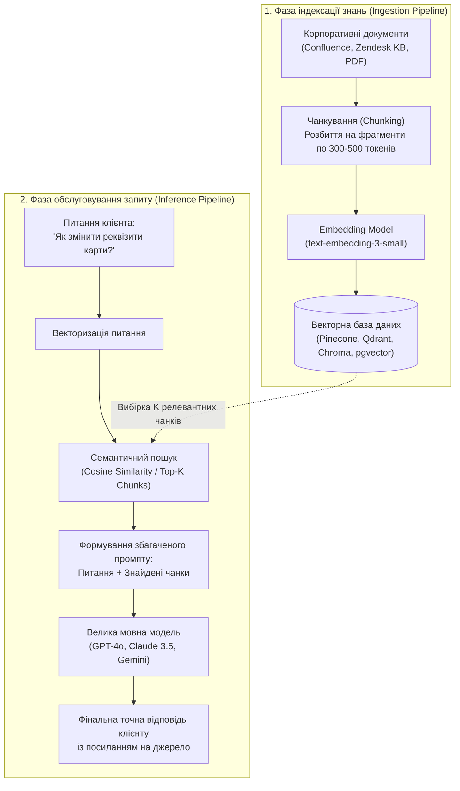

# Урок 163: RAG basics для support

## Вступ: Що таке RAG і чому звичайного ChatGPT недостатньо для підтримки

Коли компанії намагаються використовувати звичайні мовні моделі (як «чистий» ChatGPT або Claude) для відповідей клієнтам без спеціальної інфраструктури, вони негайно стикаються з двома критичними проблемами:
1. **Незнання внутрішнього контексту**: Публічна модель нічого не знає про ваш закритий продукт, вчорашній реліз або внутрішні правила повернення коштів.
2. **Галюцинації (Hallucinations)**: Не знаючи точної відповіді, модель генерує вигадані факти з надзвичайно впевненим тоном.

**Retrieval-Augmented Generation (RAG — генерація з доповненим пошуком)** — це архітектурний підхід, який об'єднує швидкісний пошук у закритій базі даних компанії з інтелектом мовної моделі. Замість того щоб змушувати AI «пам'ятати все», RAG спочатку знаходить точні актуальні документи в корпоративному сховищі, а потім передає їх у модель як контекст для формування перевіреної відповіді.

---

## 1. Архітектурний пайплайн RAG-системи у клієнтському сервісі

Класичний промисловий RAG-конвеєр для служби підтримки складається з двох великих фаз: **Індексація (Offline)** та **Пошук і Генерація (Online)**.



---

## 2. Ключові концепції: Чанкування, Ембеддінги та Векторні бази

Щоб RAG працював швидко й точно, дані проходять спеціальну математичну обробку:

1. **Чанкування (Chunking)**:
   - База знань не може зберігатися гігантськими файлами. Документи нарізаються на невеликі смислові шматочки (чанки) розміром 256–512 токенів із невеликим перекриттям (Overlap 10–20%), щоб не втратити контекст на стиках речень.
2. **Векторні ембеддінги (Vector Embeddings)**:
   - Спеціальна нейромережа перетворює текстовий чанк на масив чисел (вектор, наприклад, довжиною 1536 вимірів).
   - Тексти з близьким значенням розташовуються поруч у векторному просторі, навіть якщо в них немає жодного спільного слова (наприклад: *«повернути кошти»* та *«зробити рефанд»* мають майже ідентичні вектори).
3. **Векторні бази даних (Vector Databases)**:
   - Спеціалізовані СУБД (Pinecone, Qdrant, Weaviate, Milvus, PostgreSQL з розширенням pgvector), які можуть шукати найближчі вектори серед мільйонів записів за мілісекунди за допомогою алгоритмів HNSW (Hierarchical Navigable Small World).

---

## 3. Методи підвищення точності: Hybrid Search та Re-ranking

Простий векторний пошук інколи помиляється на точних кодах, назвах артикулів або номерах помилок. Сучасний enterprise-рівень RAG використовує комбіновані підходи:

- **Гібридний пошук (Hybrid Search)**: Поєднання семантичного векторного пошуку (розуміння сенсу) з класичним повнотекстовим пошуком за ключовими словами (BM25 / Keyword Search — точний пошук кодів помилок).
- **Переранжування (Re-ranking)**: Спеціальна модель (Cross-Encoder / Cohere Rerank) бере топ-20 знайдених фрагментів і глибоко переоцінює їхню релевантність конкретному питанню клієнта, відбираючи топ-3 найточніших чанки для передачі в LLM.

---

## 4. Метрики оцінки якості RAG: Тріада Ragas

Для контролю стабільності та точності RAG системи у підтримці використовують стандартизовані інженерні метрики:
1. **Context Precision (Точність контексту)**: Чи всі знайдені чанки дійсно стосуються питання клієнта?
2. **Faithfulness / Groundedness (Достовірність відповіді)**: Чи всі факти у відповіді моделі взяті виключно зі знайденого контексту (відсутність галюцинацій)?
3. **Answer Relevance (Релевантність відповіді)**: Чи відповідає текст безпосередньо на поставлене питання, чи він ухиляється від теми?


## Практичний інженерний розбір: Алгоритм відповіді на критичний інцидент клієнта

Розглянемо практичний випадок складання персоналізованої відповіді бізнес-клієнту (B2B SaaS), у якого виник збій синхронізації бази контактів:

### Проєкт еталонної відповіді:
```text
Шановний Ігоре, вітаю!

Я розумію, наскільки критичною є ситуація з лідами під час активної рекламної кампанії, і негайно взяв ваше питання під особистий контроль.

Головне: жоден контакт не втрачено.
Через пікове навантаження на чергу вебхуків виникла затримка обробки. Усі 142 контакти збережені в черзі Dead Letter Queue і вже імпортуються у вашу CRM. Повна синхронізація завершиться протягом 10 хвилин.

Що зроблено:
1. Виділено додаткові воркери для черги вашого акаунта.
2. Встановлено персональний моніторинг стабільності вебхука.

Я тримаю тікет на особистому контролі та надішлю підтвердження завершення.

З повагою,
Максим, провідний спеціаліст підтримки
```


## Архітектура сучасного інтелектуального клієнтського сервісу (RAG & Knowledge Base)

Сучасна служба клієнтської підтримки працює як високоточна інформаційна система, де AI виступає когнітивним помічником для швидкого та безпомилкового розв'язання проблем користувачів:

```
[Запит клієнта з описом проблеми]
                │
                ▼
[Пошук у внутрішній базі знань (Vector Semantic Search / Hybrid Search)]
                │
                ▼
[RAG-конвеєр: генерація контекстно-точного проекту відповіді]
                │
                ▼
[Верифікація актуальності: перевірка версій сервісу та прав доступу]
                │
                ▼
[Оформлення відповіді за Tone of Voice з точними лінками на інструкції]
                │
                ▼
[Надання допомоги клієнту та фіксація зворотного зв'язку для оновлення KB]
```

### Матриця верифікації відповідей підтримки (Customer Support QA Gate)

| Параметр оцінки | Зразковий показник | Неприпустима помилка (Антипатерн) | Контрольний захід спеціаліста |
| :--- | :--- | :--- | :--- |
| **Точність інформації** | 100% відповідність чинним інструкціям та правилам | Надання застарілих цін, неіснуючих функцій або галюцинацій AI | Звірка з першоджерелом у внутрішній вікі (Confluence/Notion) |
| **Емпатія та Tone of Voice** | Щира турбота, повага, відсутність бюрократичних штампів | Пасивно-агресивні фрази типу "Як було вказано в договорі..." | Адаптація тональності під емоційний стан клієнта |
| **Ясність посилань** | Прямий лінк на конкретний абзац чи інструкцію зі скріншотом | Загальне посилання на головну сторінку "Шукайте в довідці" | Перевірка працездатності посилання та якорів переходів |
| **Швидкість вирішення (FCR)**| Вирішення проблеми з першого контакту без зайвих пересилань | Багаторазове перекидання тікета між відділами | Повне взяття відповідальності за інцидент |


## Психологія вирішення конфліктів та інженерні інструменти підтримки клієнтів

Високий рівень сервісу будується на гармонійному поєднанні глибокої емпатії та системного володіння технічними інструментами:

### 1. Модель деескалації напруги HEAR:
- **Hear (Вислухати)**: Повне сприйняття проблеми без перебивання та передчасних заперечень.
- **Empathize (Проявити емпатію)**: Щире визнання дискомфорту та складності ситуації для клієнта.
- **Acknowledge (Підтвердити)**: Повторення суті проблеми власними словами, щоб клієнт відчув, що його почули.
- **Resolve (Вирішити)**: Надання чіткого плану дій з точним таймлайном та взяття персональної відповідальності.

### 2. Метрики та SLA клієнтського сервісу:
- **First Contact Resolution (FCR)**: Відсоток запитів, повністю вирішених під час першого контакту (цільовий рівень > 75%).
- **Customer Effort Score (CES)**: Оцінка того, наскільки легко клієнту було отримати допомогу.
- **Net Promoter Score (NPS)**: Готовність користувача рекомендувати сервіс друзям після взаємодії з підтримкою.


## Стандарти побудови бази знань та інтелектуальної маршрутизації звернень

Організація бази знань для роботизованих та людських ліній підтримки:

### 1. Архітектура статтей Knowledge Base:
- **Проблема**: Чіткий симптом, який шукає користувач або агент.
- **Причина**: Коротке пояснення, чому це сталося.
- **Рішення**: Покроковий алгоритм дій із наочними скріншотами.
- **Пов'язані статті**: Посилання на суміжні інструкції.

### 2. Чеклист оцінки якості роботи спеціаліста підтримки:
- [ ] Персоналізоване привітання та підтвердження розуміння суті проблеми
- [ ] Відсутність шаблонів-відписок без реальної допомоги
- [ ] Надання точного таймлайну вирішення або негайне закриття питання


## Практичний AI-Playbook спеціаліста підтримки: Калібрування Tone of Voice

Шаблони для складання емпатичних та точних відповідей клієнтам:

### Промпт для обробки ескалації та негативного фідбеку:
```text
Дій як провідний спеціаліст служби клієнтського сервісу преміум-рівня.
Клієнт надіслав наступне повідомлення у стані сильного роздратування:
[Текст звернення клієнта]
Внутрішній технічний контекст інциденту: [Короткий опис, що насправді сталося і коли буде виправлено].
Склади еталонну відповідь:
1. Визнай дискомфорт клієнта з щирою емпатією без використання бюрократичних відписок.
2. Поясни суть ситуації простими словами без прихованих виправдань.
3. Надай чіткий покроковий план вирішення та статус замовлення.
4. Запропонуй доречний компенсаційний захід або випереджальну допомогу.
```


## Архітектурний шаблон enterprise-рівня: Багаторівнева автоматизація омніканального сервісу

Обслуговування клієнтів у режимі 24/7 вимагає безшовної синергії AI-асистентів та експертних операторів:

### 1. Архітектура маршрутизації (Tiered Support Architecture):
- **Tier 0 (AI Copilot / RAG Bot)**: Миттєве закриття до 65% типових запитів за допомогою перевіреної бази знань.
- **Tier 1 (Перша лінія операторів)**: Обробка стандартних питань, перевірка статусів акаунтів, деескалація конфліктів.
- **Tier 2 (Технічні інженери підтримки)**: Глибока діагностика багів, перевірка логів у Kibana, передача дефектів команді розробки.

### 2. Матриця якості підтримки клієнтів:
- **First Response Time (FRT)**: Перша відповідь менше ніж за 45 секунд у чаті.
- **Resolution Time**: Повне закриття інциденту за регламентом SLA.
- **CSAT (Customer Satisfaction)**: Оцінка задоволеності клієнтів > 4.8 з 5.0.


## Інженерна матриця безпеки даних клієнтів та стандартів конфіденційності (GDPR & SOC 2)

Підтримка клієнтів є критичною лінією взаємодії, де оператори мають доступ до персональних та фінансових даних:

### 1. Безпека комунікацій та запобігання соціальній інженерії
- **Протокол верифікації клієнта**: Сувора заборона надання конфіденційних даних або скидання паролів без проходження клієнтом процедури підтвердження особи (2FA / OTP-код / секретне питання).
- **Захист від соціальної інженерії**: Навчання розпізнаванню фішингових запитів та спроб маніпуляцій від зловмисників під виглядом керівників або аудиторів.
- **Регламент GDPR (Right to be Forgotten)**: Чіткий алгоритм обробки запитів клієнтів на видалення персональних даних із систем CRM та резервних копій.

### 2. Чеклист безпеки та якості роботи фахівця підтримки:
- [ ] Обов'язкова верифікація особи клієнта перед виконанням чутливих операцій
- [ ] Відсутність збереження платіжних реквізитів у відкритому листуванні
- [ ] Своєчасна передача інформації про підозрілі інциденти службі кібербезпеки (InfoSec)
- [ ] Дотримання корпоративного протоколу ескалації інцидентів


## Поглиблена інженерна практика: Управління інцидентами та емоційна стійкість команди

Професійний клієнтський сервіс у технологічних компаніях поєднує високі стандарти комунікації з інженерною експертизою:

### 1. Протокол дій під час масштабних інцидентів (Major Incident Response)
Коли трапляється глобальний збій інфраструктури (Downtime, аварія дата-центру):
- **Синхронізація зі штабом інциденту (Incident Commander)**: Отримання достовірної інформації про масштаби проблеми та орієнтовний час відновлення (ETA).
- **Публікація статусів на Status Page**: Оперативне інформування спільноти на офіційній сторінці статусу (наприклад, In Progress, Monitoring) для зменшення кількості однотипних вхідних тікетів.
- **Проактивне масове сповіщення**: Розсилка банерів у вебзастосунку та ботах із поясненням ситуації та запевненням, що команда інженерів уже працює над усуненням аварії.

### 2. Професійна деескалація та стандарти сервісу
- **Техніка активного слухання та емпатії**: Визнання емоцій клієнта без прийняття необґрунтованої провини («Я розумію, як це неприємно, коли платіж затримується, і зараз особисто перевірю стан транзакції»).
- **Уникнення бюрократичного стилю**: Спілкування простою людською мовою без заплутаного технічного жаргону.
- **Профілактика вигорання персоналу**: Ротація змін, аналіз складних кейсів на супервізіях та підтримка доброзичливої командної атмосфери.


## Інженерний інструментарій сервісної підтримки (Customer Service Toolkit)

Висока швидкість та якість обслуговування досягаються за допомогою сучасного інструментарію:
- **Омніканальні хмарні платформи**: Zendesk Support, Freshdesk, Intercom для агрегації звернень із чатів, пошти, соціальних мереж та месенджерів в єдину чергу.
- **Внутрішні діагностичні дашборди**: Metabase, Grafana та Postman для швидкої перевірки статусу підписок клієнта, останніх транзакцій та перевірки здоров'я систем без необхідності турбувати чергових розробників.
- **Асинхронний відеозв'язок (Loom, CloudApp)**: Запис коротких наочних відеопояснень та скринкастів складних кроків налаштування замість довгих текстових листувань.


## Комплексний інженерний чеклист якості обслуговування клієнтів (Support Excellence Gate)

Перед закриттям звернення та відправленням фінальної відповіді користувачеві:
1. **Повнота та точність відповіді**:
   - [ ] Питання клієнта вирішено повністю з першого разу (First Contact Resolution), надано чіткі покрокові інструкції.
   - [ ] Надано прямі клікабельні посилання на офіційні статті Бази знань та документацію продукту.
2. **Емпатія та корпоративний тон**:
   - [ ] Тон звернення доброзичливий, підтримуючий, персоналізований, відсутні сухі роботизовані шаблони.
   - [ ] Проявлено щиру турботу про ситуацію клієнта, запропоновано подальшу допомогу за потреби.
3. **Безпека та системна фіксація**:
   - [ ] У листуванні відсутні конфіденційні дані (паролі, повні номери карток, платіжні секрети).
   - [ ] Тікет коректно протеґовано за категорією проблеми, версією ОС та функціональним модулем для аналітики продукту.


## Практичний інженерний кейс-стаді: Управління масовим інцидентом під час релізу

Розглянемо практичний досвід служби підтримки під час раптового збою сервісу авторизації:
1. **Кризова ситуація**: Після п'ятничного оновлення системи 30 000 користувачів одночасно втратили доступ до особистих кабінетів через збій OAuth провайдера. Вхідна черга тікетів зросла у 20 разів за перші 15 хвилин.
2. **Координація дій команди**:
   - Негайне оголошення статусу Major Incident та активація кризового чату зі штабом чергових інженерів.
   - Створення та розгортання єдиного інформаційного банера в інтерфейсі вебзастосунку та на офіційній Status Page, що попередило нові звернення.
   - Застосування попередньо узгоджених макросів емпатичної комунікації з точним поясненням ситуації та запевненням, що дані користувачів у повній безпеці.
   - Запуск AI-асистента першої лінії з налаштованою базою для автоматичного закриття 70% типових звернень із запевненням про відновлення.
   - Результат: Відновлення нормальної черги без втрати довіри клієнтів та збереження CSAT на рівні 4.7 з 5.0.


## Комплексні KPI ефективності клієнтського сервісу та лояльності (Support Operational Excellence)

Робота сучасної служби підтримки керується збалансованою системою операційних метрик:
1. **Операційна швидкість та доступність**:
   - **First Response Time (FRT)**: Середній час очікування першої відповіді живого оператора (цільовий рівень — менше 60 секунд у чаті).
   - **First Contact Resolution (FCR)**: Відсоток звернень, вирішених під час першого контакту без додаткових листувань (цільовий рівень — понад 75%).
2. **Якість обслуговування та задоволеність**:
   - **CSAT (Customer Satisfaction Score)**: Відсоток позитивних оцінок (4 і 5 зірок) за підсумками закритого тікета (цільовий рівень — > 92%).
   - **Customer Effort Score (CES)**: Оцінка зусиль, яких клієнт доклав для вирішення своєї проблеми («Наскільки легко було отримати допомогу?»).
   - **Net Promoter Score (NPS)**: Готовність рекомендувати продукт друзям і колегам.


## Інтеграція генеративного AI в службу підтримки: Розумна маршрутизація та предиктивний аналіз

Штучний інтелект у сучасному контакт-центрі виходить далеко за межі простих чат-ботів:
1. **Інтелектуальна маршрутизація (Intent-based Routing)**: Миттєве визначення теми звернення та рівня стресу клієнта за першим повідомленням для направлення на вузькопрофільного експерта.
2. **Автоматична підготовка контексту (Context Pre-fetching)**: Під час відкриття тікета AI збирає для оператора останні дії користувача, статус його замовлення та схожі закриті інциденти.
3. **Аналіз ризику відтоку (Churn Prevention)**: Виявлення розчарованих клієнтів за тональністю повідомлень для проактивного надання бонусів та збереження лояльності.


## Поглиблений менеджмент сервісу: Організація омніканальності та кризисних комунікацій

Підтримка клієнтів у масштабованих бізнесах функціонує за строгими протоколами безпеки та взаємодії:
- **Омніканальна єдність (Omnichannel Orchestration)**: Безшовний перехід клієнта між чатом, поштою та телефонним дзвінком зі збереженням повної хронології переписки в єдиному профілі CRM.
- **Протокол ескалації інцидентів (Incident Management Tree)**: Дії першої лінії при виникненні масового збою (P1 Outage): публікація Status Page, запуск шаблонів масового інформування та зв'язок із черговими інженерами DevOps.
- **Аналіз кореневих причин (Root Cause Analysis)**: Регулярний аналіз топ-10 причин звернень клієнтів для формування пропозицій продуктовим командам щодо покращення UX застосунку.


## Підсумковий інженерний огляд та практичні рекомендації

Опанування теми **«RAG basics для support»** є ключовим будівельним блоком у професійному становленні спеціаліста за напрямком **AI Customer Support Specialist**. Системне застосування розглянутих методологій дозволяє:
1. **Забезпечити максимальну надійність та стабільність рішень**, спираючись на перевірені індустріальні патерни та міжнародні стандарти.
2. **Усунути людський фактор та сліпі зони**, використовуючи матриці контролю якості, автоматизовані тести та перехресну валідацію.
3. **Ефективно інтегрувати сучасні AI-інструменти** у щоденний виробничий конвеєр, виступаючи в ролі кваліфікованого інженера-архітектора, який ставить точні завдання та критично верифікує результат.
