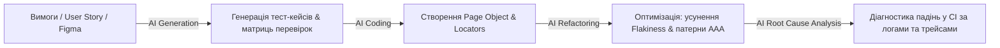

# Урок 148: Створення UI-автотестів за допомогою AI

## Вступ: Нова ера AI-Augmented Test Engineering

Поява генеративного штучного інтелекту та спеціалізованих інструментів розробки (GitHub Copilot, Cursor, Claude 3.5 Sonnet, ChatGPT) докорінно трансформувала професію QA Automation інженера. Рутинне написання однотипних локаторів, складання каркасів Page Object та механічне перетворення вимог на тестовий код тепер делегується AI.

Проте штучний інтелект не замінює інженера: він виступає в ролі високоефективного цифрового джуніора або парного програміста. Завдання SDET полягає у формуванні точного контексту, постановці архітектурних рамок, критичному код-рев'ю згенерованих тестів та верифікації їхньої стійкості у виробничому середовищі.

---

## 1. Сфери застосування AI в автоматизації Web UI

Штучний інтелект демонструє найвищу ефективність на наступних етапах:



1. **Генерація тестів з опису бізнес-вимог**:
   - Перетворення неструктурованого тексту User Story або критеріїв приймання (Acceptance Criteria) у структуровані сценарії Playwright на TypeScript.
2. **Створення Page Object за фрагментом DOM або скріншотом**:
   - Мультимодальні моделі (Claude 3.5 Sonnet, GPT-4o) можуть аналізувати скріншот форми або вихідний HTML-код компонента та миттєво генерувати чистий клас із семантичними ролями `getByRole`.
3. **Діагностика та самовідновлення (Self-Healing & RCA)**:
   - Передача логу падіння тесту та фрагмента Playwright Trace в AI для швидкого з'ясування: чи змінився локатор, чи бекенд повернув неочікуваний статус 500, чи виникла проблема розсинхронізації.

---

## 2. Промпт-інжиніринг для SDET: Структура системного промпту

Якість згенерованого AI коду на 90% залежить від повноти контексту. Слабкий промпт ("напиши тест для форми логіну") завжди призведе до генерації застарілого коду з жорсткими таймаутами та крихкими CSS-селекторами.

### Золотий шаблон промпту для генерації автотестів:

```text
[РОЛЬ І ЕКСПЕРТИЗА]
Дій як Staff SDET / QA Automation Architect зі спеціалізацією на Playwright та TypeScript.

[КОНТЕКСТ ТА СТЕК]
Проєкт: Фінтех-платформа з високими вимогами до безпеки та стабільності.
Стек: Playwright Test, TypeScript, Page Object Model, семантичні локатори за стандартом W3C WAI-ARIA.

[ВХІДНІ ДАНІ]
Ось фрагмент HTML-розмітки компонента або сторінки:
<form aria-label="Форма відкриття депозиту">
  <label for="amount">Сума вкладу (грн)</label>
  <input id="amount" type="number" min="1000" required />
  ...
</form>

[АРХІТЕКТУРНІ ОБМЕЖЕННЯ]
1. Використовуй ВИКЛЮЧНО семантичні локатори (getByRole, getByLabel). Жодних абсолютних XPath або Tailwind класів.
2. Суворо дотримуйся структури Arrange, Act, Assert.
3. Використовуй Web-first assertions (expect(locator).toBeVisible()).
4. Заборонено використовувати будь-які waitForTimeout().
5. Типізуй усі методи без використання `any`.

[ОЧІКУВАНИЙ АРТЕФАКТ]
Надай:
1. Клас Page Object `DepositPage.ts`.
2. Тестовий файл `deposit.spec.ts` з позитивним сценарієм та одним негативним крайовим випадком.
```

---

## 3. Використання Cursor та Copilot безпосередньо в IDE

Сучасні AI-редактори надають безпрецедентну швидкість розробки завдяки розумінню всієї кодової бази:

1. **Файл системних інструкцій `.cursorrules` / `.github/copilot-instructions.md`**:
   - Фіксація корпоративних стандартів автотестування прямо в корені репозиторію.
   - AI автоматично дотримується ваших угод щодо імен файлів, використання фікстур та структури POM при генерації будь-якого тесту.

```markdown
# Корпоративні правила для автотестів Playwright:
- Усі нові тести повинні писатися виключно на TypeScript.
- Локатори оголошуються тільки через getByRole, getByLabel або getByTestId.
- Заборонено пряме використання page.goto() у тілі тесту — тільки через Page Object або фікстури.
- Усі перевірки стану здійснюються через Web-First assertions.
```

2. **Inline генерація через гарячі клавіші (Cmd+K / Ctrl+K)**:
   - Виділення тестового сценарію та команда: "Огорни цей потік у нову фікстуру `authenticatedUser` з автоматичним видаленням сутності через API".

---

## 4. Пастки, ризики та верифікація згенерованого AI коду

Незважаючи на потужність AI, сліпа довіра до його результатів є неприпустимою:

1. **Галюцинації локаторів**: AI часто вигадує зручні йому доступні імена (Accessible Names) або атрибути `data-testid`, яких насправді немає у верстці продукту.
2. **Маскування проблем через Force Clicks**: AI може автоматично додати `{ force: true }`, коли бачить падіння через перекриття елемента, замість виправлення справжньої причини перекриття.
3. **Хибнопозитивні тести (False Positives)**: AI може згенерувати перевірку, яка завжди проходить (наприклад, перевірка `expect(locator.isVisible()).toBeTruthy()`, де пропущено `await`, внаслідок чого перевіряється об'єкт Promise, який завжди truthy!).
4. **Обов'язкове правило інженера**: Кожен згенерований AI тест повинен бути запущений локально, перевірений на штучне падіння (Negative Testing of the Test) та переглянутий у Trace Viewer перед додаванням у репозиторій.


## Практичний інженерний розбір: Реалізація відмовостійкого Page Object Model фреймворку

Розглянемо приклад реалізації архітектури Page Object Model (POM) із використанням Playwright, кастомних фікстур та надійних селекторів:

```typescript
// pages/CheckoutPage.ts
import { expect, type Locator, type Page } from '@playwright/test';

export class CheckoutPage {
  readonly page: Page;
  readonly nameInput: Locator;
  readonly addressInput: Locator;
  readonly paymentMethodSelect: Locator;
  readonly submitButton: Locator;
  readonly successMessage: Locator;

  constructor(page: Page) {
    this.page = page;
    this.nameInput = page.getByRole('textbox', { name: "Повне ім'я" });
    this.addressInput = page.getByRole('textbox', { name: 'Адреса доставки' });
    this.paymentMethodSelect = page.getByRole('combobox', { name: 'Спосіб оплати' });
    this.submitButton = page.getByRole('button', { name: 'Підтвердити замовлення' });
    this.successMessage = page.getByRole('status');
  }

  async goto() {
    await this.page.goto('/checkout');
    await expect(this.nameInput).toBeVisible();
  }

  async fillShippingDetails(name: string, address: string) {
    await this.nameInput.fill(name);
    await this.addressInput.fill(address);
  }

  async selectPaymentMethod(method: string) {
    await this.paymentMethodSelect.selectOption({ label: method });
  }

  async submitOrder() {
    await this.submitButton.click();
  }

  async verifyOrderSuccess() {
    await expect(this.successMessage).toBeVisible({ timeout: 5000 });
    await expect(this.successMessage).toContainText('Замовлення успішно створено');
  }
}
```

```typescript
// tests/checkout.spec.ts
import { test } from '@playwright/test';
import { CheckoutPage } from '../pages/CheckoutPage';

test.describe('E2E Модуль оформлення замовлення', () => {
  test('Успішне оформлення замовлення з валідними даними', async ({ page }) => {
    const checkout = new CheckoutPage(page);
    await checkout.goto();
    await checkout.fillShippingDetails('Олександр Коваль', 'м. Київ, вул. Хрещатик, 1');
    await checkout.selectPaymentMethod('Банківська картка');
    await checkout.submitOrder();
    await checkout.verifyOrderSuccess();
  });
});
```


## Архітектурні патерни автоматизації Web UI на базі Playwright

Створення сучасного фреймворку автоматизації тестування вимагає застосування передових шаблонів проєктування та відмовостійких рішень:

```
[Тестовий сценарій / Специфікація]
               │
               ▼
[Playwright Test Runner з автоочікуванням (Auto-waiting)]
               │
               ▼
[Page Object Model (POM) / Screenplay Pattern]
               │
               ▼
[Семантичні локатори користувача (getByRole, getByText, getByTestId)]
               │
               ▼
[Ізольовані кастомні фікстури (Fixtures: StorageState, Page, API context)]
               │
               ▼
[Паралельний прогін у браузерних контекстах (Chromium, Firefox, WebKit)]
               │
               ▼
[Аналіз трасування (Playwright Trace Viewer, Allure Reports)]
```

### Порівняльна матриця стратегій локації елементів

| Тип локатора | Приклад синтаксису | Рівень стабільності | Чому рекомендовано / не рекомендовано |
| :--- | :--- | :--- | :--- |
| **Семантична роль (W3C)**| `page.getByRole('button', { name: 'Submit' })` | **Максимальний (Tier 1)** | Тестує інтерфейс так, як його бачить людина; стійкий до рефакторингу CSS |
| **Тестовий ID** | `page.getByTestId('submit-order-btn')` | **Високий (Tier 1)** | Ізольований атрибут, призначений спеціально для автотестів |
| **Текстовий контент** | `page.getByText('Замовлення оформлено')` | **Високий (Tier 2)** | Ідеально для перевірки повідомлень, залежить від локалізації |
| **CSS селектори** | `page.locator('.checkout-container > div.btn-primary')`| **Низький (Tier 3)** | Легко ламається при будь-якій зміні класів або структури верстки |
| **Абсолютний XPath** | `page.locator('/html/body/div[2]/form/button[1]')` | **Критично низький (Anti-pattern)** | Руйнується при найменшій зміні DOM; категорично заборонено |

### Чеклист стійкості UI автотестів проти флакі-поведінки (Flaky Tests):
- [ ] Повна відмова від жорстких пауз `page.waitForTimeout()` на користь веб-асертів `expect(locator).toBeVisible()`
- [ ] Ізоляція тестового середовища: кожен тест запускається у свіжому браузерному контексті (`BrowserContext`)
- [ ] Використання збереженого стану сесії (`storageState`) для пропуску рутинного UI-логіну у кожному тесті
- [ ] Автоматичний збір трасувань (`trace: 'retain-on-failure'`) та скріншотів у разі падіння тесту в CI/CD


## Інженерія стабільних автоматизованих тест-сьютів на рівні Enterprise

Створення тестів, які не падають від найменших коливань мережі, вимагає знання глибинних механізмів браузерної автоматизації:

### 1. Механіка Auto-Waiting та Web-First Assertions
Playwright усунув потребу в явних `sleep` завдяки патерну Actionability Checks. Перед виконанням будь-якої дії (клік, заповнення) рушій перевіряє:
- Елемент прикріплений до DOM (Attached)
- Елемент є видимим (Visible, не має `display: none` чи `opacity: 0`)
- Елемент стабільний (Stable, не виконує CSS-анімацію переміщення)
- Елемент увімкнений (Enabled, не має атрибута `disabled`)
- Елемент приймає події (Receives Events, не перекритий модальним бекдропом)

### 2. Патерн Screenplay проти класичного Page Object
У великих проєктах класичний Page Object Model починає розростатися до God Objects на 2000 рядків. Альтернативою є патерн **Screenplay**:
- Тест фокусується на Акторі (Actor) та його Здатностях (Abilities).
- Кожна дія є окремим класом задачі (Task), наприклад `OpenBillingSettings.performAs(actor)`.
- Забезпечується максимальне перевикористання коду та легкість читання нетехнічними фахівцями.


## Стратегія побудови стабільного пайплайну автоматизації (CI/CD Quality Gate)

Автоматизовані тести мають цінність лише тоді, коли вони стабільно та швидко виконуються в конвеєрі неперервної інтеграції:

### 1. Архітектурні принципи побудови CI/CD тест-сьютів:
- **Паралелізація**: Запуск тестів у N паралельних потоках (Playwright Workers) з шардуванням на рівні контейнерів GitHub Actions.
- **Тестові середовища (Ephemeral Environments)**: Розгортання ізольованих динамічних preview-оточень на кожен Pull Request.
- **Flaky-менеджмент**: Автоматичний карантин для нестабільних тестів із негайною нотифікацією команди.

### 2. Чеклист оптимізації тестів:
- [ ] Використання API-запитів для передумов замість повільних кліків через UI
- [ ] Налаштований повтор (Retries: 2) лише для нічних регресійних прогонів
- [ ] Збереження відео та трейсів виключно для впавших тестів (`trace: retain-on-failure`)


## Практичний AI-Playbook QA Automation: Генерація Page Object моделей

Шаблони для генерації архітектури тестів на Playwright:

### Промпт для створення Page Object класу з HTML-розмітки:
```text
Дій як Senior SDET. Ось фрагмент HTML-розмітки веб-сторінки [Вставити HTML або посилання на UI]:
Створи для цієї сторінки клас Page Object Model на TypeScript для фреймворку Playwright.
Вимоги:
1. Використовуй виключно семантичні локатори (getByRole, getByLabel, getByTestId).
2. Інкапсулюй бізнес-дії у високорівневі методи (наприклад, login(), addItemToCart()).
3. Додай методи перевірки стану за допомогою web-first assertions (expect(locator).toBeVisible()).
4. Напиши приклад тестового сценарію test() із використанням створеного класу.
```


## Архітектурний шаблон enterprise-рівня: Відмовостійка тестова інфраструктура

Масштабування тестового набору до десятків тисяч автотестів вимагає промислового підходу до інфраструктури:

### 1. Архітектура хмарного виконання тестів (Grid / Sharding):
- Запуск тестів у розподіленому кластері Kubernetes (Playwright Grid).
- Автоматичний поділ сьютів на рівні джоб (Matrix Sharding: 10 паралельних контейнерів скорочують час прогону з 1 години до 6 хвилин).
- Інтеграція з Allure TestOps для аналізу трендів стабільності тестового покриття.

### 2. Матриця стабільності автотестів:
- **Pass Rate**: Цільовий показник стабільності > 99.2% на стабільній гілці main.
- **Execution Time**: Середня тривалість одного UI-тесту не більше 15 секунд.
- **Zero Flakiness**: Відсутність тестів, які падають випадковим чином через проблеми з мережею чи таймінгами.


## Інженерна матриця безпеки тестової інфраструктури та безперервної інтеграції

Автоматизація тестування є невіддільною частиною захищеного конвеєра DevSecOps:

### 1. Безпека тестових середовищ та секретів у CI/CD
- **Управління тестовими секретами**: Використання HashiCorp Vault або GitHub Encrypted Secrets для передачі авторизаційних токенів у раннери тестів. Заборонено зберігати паролі у тестових конфігураційних файлах репозиторію.
- **Ізоляція тестових баз даних**: Автоматичне створення та знищення ефемерних баз даних (Testcontainers) для кожного паралельного потоку тестів, що унеможливлює стан гонки за даними (Data Race).
- **Матриця покриття тест-сьюту (Coverage Matrix)**: Балансування між швидкістю виконання (Fast Smoke < 3 хв) та глибиною покриття (Full Regression < 20 хв) за допомогою шардування та розумного відбору тестів (Test Impact Analysis).

### 2. Чеклист стабільності та безпеки автотестів:
- [ ] Відсутність захардкодzoneних паролів та конфіденційних даних у коді тестів
- [ ] 100% незалежність тестів один від одного (Test Independence)
- [ ] Автоматичне очищення створених тестових сутностей (Teardown Cleanup)
- [ ] Надійний збір артефактів падіння без перевантаження сховища артефактів


## Поглиблена інженерна практика: Масштабована архітектура та управління стабільністю тестів

Створення довговічного фреймворку автоматизації UI вимагає дотримання архітектурних принципів проєктування програмного забезпечення:

### 1. Боротьба з нестабільними тестами (Flaky Tests Elimination)
Нестабільні тести руйнують довіру команди до автотестів. Основні інженерні практики запобігання флакі-тестам:
1. **Відмова від жорстких затримок (Zero Hardcoded Sleep)**: Використання виключно розумних авто-очікувань Playwright, які слухають події DOM, мережевий трафік та анімації.
2. **Ізоляція тестового середовища (Test Isolation)**: Кожен тест повинен створювати власний стан через API або перехоплення (mocking), не залежачи від попередньо запущених сценаріїв.
3. **Детерміновані дані**: Використання динамічно згенерованих тестових даних (фікстури Faker) та автоматичне очищення сутностей після завершення тесту (Teardown hooks).

### 2. Масштабування автотестів у CI/CD
- **Playwright Sharding**: Розподіл виконання тестового набору на N паралельних потоків (машин) у GitHub Actions, що скорочує час проходження з 40 хвилин до 3-5 хвилин.
- **Збереження діагностичних артефактів**: Автоматичне збереження Playwright Trace Viewer, відеозаписів та скріншотів лише для впалих тестів для збереження пам'яті сервера.
- **Аналітика та трендова звітність**: Публікація Allure Reports або інтеграція з ReportPortal для відстеження динаміки стабільності тестового набору в часі.


## Інженерний інструментарій автотестування (SDET Automation Toolkit)

Побудова промислового фреймворку спирається на сучасну екосистему інструментів тестування:
- **Playwright Codegen та Inspector**: Миттєвий запис дій користувача та інтерактивне налагодження кроків тесту в режимі реального часу з покроковим виконанням.
- **Trace Viewer**: Повний запис проходження тесту зі збереженням DOM-знімків для кожного мікро-кроку, консольних логів браузера та таймлайну мережевих запитів.
- **Контейнеризоване паралельне тестування**: Запуск тестів у хмарних Docker-контейнерах Playwright у GitHub Actions, що усуває проблеми розбіжностей у системних шрифтах, ОС та рендерингу браузерів.


## Комплексний інженерний чеклист рев'ю автотестів (SDET Code Review Gate)

Перед злиттям нових тестів в основну гілку репозиторію тестування:
1. **Надійність локаторів**:
   - [ ] Тести спираються на семантичні ролі (`getByRole`, `getByLabel`) або стабільні `data-testid`, жорсткі XPath/CSS класи відсутні.
   - [ ] Жоден локатор не прив'язаний до динамічно генерованих хешів стилів Tailwind або CSS-in-JS.
2. **Детермінізм та стабільність**:
   - [ ] Відсутні явні паузи (`page.waitForTimeout`), очікування реалізовані через вбудовані Web-first Assertions.
   - [ ] Тести повністю автономні та можуть виконуватися у довільному порядку в паралельних потоках.
3. **Артефакти та звітність**:
   - [ ] Налаштовано збереження скріншотів, відео та Playwright Tracing при падінні тестів у CI.
   - [ ] Час виконання тестового набору оптимізовано завдяки шардингу та повторному використанню збереженого стану сесії (StorageState).


## Практичний інженерний кейс-стаді: Масштабування тестового набору в CI/CD

Розглянемо практичний досвід оптимізації регресійного набору з понад 600 E2E автотестів на Playwright:
1. **Початковий стан**: Повний прогін регресії в один потік на CI сервері займав 2 години 45 хвилин, що блокувало релізи та створювало черги серед розробників.
2. **Впроваджені архітектурні зміни**:
   - **Шардинг (Test Sharding)**: Розподіл тестів на 6 паралельних контейнерів у GitHub Actions за допомогою прапорця `--shard=1/6`, що скоротило час виконання до 18 хвилин.
   - **Авторизація через StorageState**: Відмова від проходження форми логіну в кожному тесті на користь єдиної глобальної авторизації перед прогоном зберегла понад 35 хвилин сумарного часу.
   - **Селективний запуск (Test Tagging)**: Розподіл тестів на категорії `@smoke`, `@regression`, `@critical` дозволив запускати швидкий 3-хвилинний смоук на кожен Pull Request.


## Розрахунок економічної ефективності (ROI) та метрики надійності автотестів

Впровадження автоматизації тестування — це інвестиційний інженерний проєкт, окупність якого розраховується математично:
1. **Формула окупності інвестицій (Test Automation ROI)**:
   $$\text{ROI} = \frac{(\text{Час ручного прогону} \times \text{Кількість прогонів} \times \text{Ставка}) - \text{Витрати на автоматизацію}}{\text{Витрати на автоматизацію}} \times 100\%$$
   Автоматизовані тести Playwright зазвичай демонструють позитивний ROI вже після 4-6 повних циклів регресійного тестування.
2. **Метрики стабільності тестового конвеєра**:
   - **Flakiness Index**: Відсоток нестабільних тестів у збірці (повинен бути строго < 1%).
   - **Total Pipeline Execution Time**: Час виконання повного смоук-набору в CI (цільовий рівень — до 5 хвилин завдяки паралелізації).


## Підсумковий інженерний огляд та практичні рекомендації

Опанування теми **«Створення UI-автотестів за допомогою AI»** є ключовим будівельним блоком у професійному становленні спеціаліста за напрямком **AI QA Automation**. Системне застосування розглянутих методологій дозволяє:
1. **Забезпечити максимальну надійність та стабільність рішень**, спираючись на перевірені індустріальні патерни та міжнародні стандарти.
2. **Усунути людський фактор та сліпі зони**, використовуючи матриці контролю якості, автоматизовані тести та перехресну валідацію.
3. **Ефективно інтегрувати сучасні AI-інструменти** у щоденний виробничий конвеєр, виступаючи в ролі кваліфікованого інженера-архітектора, який ставить точні завдання та критично верифікує результат.
