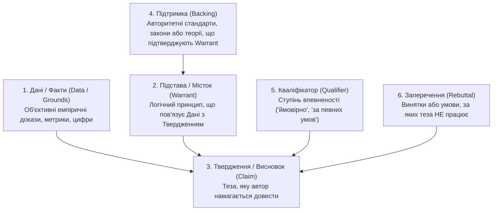

# Урок 157: Витягування фактів та аргументів

## Вступ: Факти проти інтерпретацій та маніпуляцій

У будь-якому аналітичному дослідженні найціннішим і водночас найбільш дефіцитним ресурсом є об'єктивний факт. Більшість публічних матеріалів — це гримуча суміш із реальних фактів, суб'єктивних інтерпретацій авторів, маркетингових гіпербол, риторичних фігур та емоційних суджень.

Здатність аналітика препарувати текст, немов хірург, відокремлюючи тверде зерно фактів від лушпиння думок та маніпулятивних аргументів, є ознакою найвищого професіоналізму. **Витягування фактів та аргументів (Fact & Argument Extraction)** — це методологія формалізації та верифікації тверджень, перевірки логічної спроможності аргументації та структури доказів.

---

## 1. Модель аргументації Стівена Тулміна (Toulmin Model)

Для розбору складних аргументів у філософії та інженерії знань використовується класична модель Стівена Тулміна, яка розкладає будь-яке висловлювання на шість складових компонентів:



### Приклад розбору інженерного аргументу за моделлю Тулміна:
- **Дані (Grounds)**: «Час відповіді бази даних PostgreSQL зріс з 15 мс до 450 мс після досягнення обсягу таблиці у 10 мільйонів рядків».
- **Твердження (Claim)**: «Нам необхідно впровадити партиціонування (Partitioning) та шардинг таблиці».
- **Підстава (Warrant)**: «Партиціонування зменшує розмір B-Tree індексів у пам'яті RAM, повертаючи швидкість пошуку до значень <20 мс».
- **Підтримка (Backing)**: «Офіційна документація PostgreSQL та бенчмарки продуктивності високонавантажених баз даних».
- **Кваліфікатор (Qualifier)**: «З високою ймовірністю (у 95% випадків)».
- **Заперечення (Rebuttal)**: «Якщо тільки деградація не викликана блокуванням транзакцій або повільними дисками NVMe».

---

## 2. Типологія логічних помилок та маніпуляцій (Logical Fallacies)

Під час витягування аргументів важливо негайно маркувати хибні логічні конструкції:

1. **Апеляція до авторитету (Ad Verecundiam)**: «Ця технологія найкраща, тому що про це написав у твіттері відомий блогер». (Без надання технічних метрик).
2. **Опудало (Straw Man)**: Спотворення аргументу опонента для легшої критики (наприклад: «Прихильники мікросервісів хочуть перетворити систему на некерований хаос із тисячі репозиторіїв»).
3. **Хибна дилема (False Dilemma / Black-and-White)**: Нав'язування вибору між двома крайностями: «Або ми повністю переписуємо весь проєкт на Rust, або наш бізнес збанкрутує».
4. **Після цього — значить внаслідок цього (Post Hoc Ergo Propter Hoc)**: Плутанина між кореляцією та причинно-наслідковим зв'язком (наприклад: «Ми найняли нового менеджера, і сервер впав наступного дня»).
5. **Упередження підтвердження (Confirmation Bias)**: Вибірковий витяг лише тих фактів, які підтверджують улюблену гіпотезу дослідника, з ігноруванням спростовних даних.

---

## 3. Інформаційна екстракція за допомогою AI: Побудова графів знань (Knowledge Graphs)

Сучасні LLM дозволяють автоматизувати процес витягування сутностей та зв'язків:
- **Named Entity Recognition (NER)**: Виявлення людей, організацій, технологій, числових показників, дат та локацій у тексті.
- **Relation Extraction (Витяг зв'язків)**: Формування семантичних трійок `(Суб'єкт -> Предикат -> Об'єкт)`:
  - `[База даних Redis] -> [використовує для кешування] -> [Оперативну пам'ять RAM]`
  - `[Компанія Google] -> [випустила модель] -> [Gemini 1.5]`
- Побудовані трійки експортуються у графові бази даних (Neo4j) для миттєвого візуального аналізу складних взаємозв'язків у великих архітектурних проєктах.

---

## 4. Верифікація фактів (Fact-Checking Pipeline)

Жоден витягнутий факт не потрапляє у фінальний звіт без проходження фільтра перевірки:
1. **Ідентифікація першоджерела**: Хто перший провів це вимірювання?
2. **Перевірка одиниць вимірювання**: Чи не переплутані мегабіти (Mbps) та мегабайти (MB/s)? Чи враховано інфляцію у фінансових цифрах?
3. **Контекст вибірки**: На якій кількості спостережень базується твердження? (Висновок на основі 5 тестів не є статистично значущим).


## Практичний інженерний розбір: Створення технічної матриці порівняння архітектур

Розглянемо приклад підготовки аналітичного звіту для CTO щодо порівняння рішень зберігання даних для мікросервісів:

### Зразок аналітичного висновку (Executive Summary):
> *«На основі аналізу 4 технічних джерел (документація Redis v7.2, PostgreSQL v16, benchmark Uber Engineering та GDPR), для кешування сесій рекомендовано Redis Cluster, а для фінансових транзакцій — PostgreSQL із Serializable».*

### Матриця синтезу та крос-перевірки:
| Параметр порівняння | Redis (In-Memory) | PostgreSQL (RDBMS) | MongoDB (Document) | Рівень достовірності джерела |
| :--- | :--- | :--- | :--- | :--- |
| **Латентність запису (p99)** | < 1 ms | 15–30 ms | 5–10 ms | Tier 1 (Офіційні бенчмарки) |
| **Підтримка ACID** | Часткова (MULTI/EXEC) | Повна (Строга) | На рівні документа | Tier 1 (Специфікація ISO) |
| **Масштабованість** | Шардування кластера | Реплікація Read-Only | Нативне шардування | Tier 2 (Досвід індустрії) |
| **Складність адміністрування**| Низька/Середня | Середня/Висока | Середня | Tier 2 (DevOps звіти) |


## Методологія аналітичної обробки інформації та структурування знань

Робота технічного письменника та дослідника над складними масивами документації вимагає системного підходу до фільтрації, класифікації та виявлення суперечностей:

```
[Масив первинних даних: специфікації, звіти, інтерв'ю, код]
                     │
                     ▼
[Фільтрація та попереднє структурування (Claim & Fact Extraction)]
                     │
                     ▼
[Крос-аналіз та виявлення прихованих суперечностей (Contradiction Matrix)]
                     │
                     ▼
[Класифікація інформації за таксономіями та онтологіями]
                     │
                     ▼
[Формування структурованих технічних нотаток (Atomic Zettelkasten)]
                     │
                     ▼
[Створення фінального технічного артефакту (SRS, Whitepaper, Документація)]
```

### Матриця валідації достовірності та несуперечливості знань

| Критерій оцінки | Ознака високої якості | Маркери ризику / розбіжності | Метод усунення проблеми |
| :--- | :--- | :--- | :--- |
| **Фактологічна узгодженість** | Однозначні цифри, версії та терміни в усіх розділах | Різні дати запуску чи описи функціоналу в різних версіях доків | Створення єдиного глосарію (Single Source of Truth) |
| **Логічна повнота** | Описано передумови, кроки та результати кожного процесу | Пропущені критичні кроки конфігурації або вимоги оточення | Трасування від входу до виходу (End-to-End Walkthrough) |
| **Актуальність джерел** | Посилання на офіційні репозиторії, RFC, чинні нормативні акти | Посилання на застарілі блоги або непідтверджені цитати | Перевірка дати першоджерела та версії бібліотеки |
| **Лаконічність структури** | Принцип піраміди Мінто (головний висновок -> деталі) | Розмиті формулювання, надлишкова "вода", втрата фокусу | Застосування структурних шаблонів (Markdown/Doc-as-Code) |


## Системний підхід до управління знаннями та технічної верифікації

Управління технічним контентом у великих організаціях потребує використання сучасних видавничих стандартів:

### 1. Концепція Single Source of Truth (SSOT)
- Інформація про будь-який технічний параметр (наприклад, ліміт розміру файлу або URL ендпоінта) визначається рівно в одному конфігураційному файлі.
- Усі документи, API-довідники та користувацькі інструкції автоматично підтягують це значення під час збірки.
- Зміна параметра в одному місці гарантує його миттєве оновлення в усій документації компанії.

### 2. Методологія виявлення когнітивних упереджень та маніпуляцій у текстах:
- **Confirmation Bias (Упередження підтвердження)**: Схильність шукати лише ті джерела, які підтверджують початкову гіпотезу автора.
- **Cherry Picking**: Вибіркове цитування окремих вигідних цифр з ігноруванням загального статистичного контексту.
- **Correlation vs Causation**: Плутанина між кореляцією двох подій та їх реальним причинно-наслідковим зв'язком.


## Протокол верифікації та підтримки технічної документації

Документація повинна бути надійною інженерною інструкцією, а не абстрактним описом:

### 1. Підхід Docs-as-Code:
- Зберігання технічної документації у репозиторії поруч із вихідним кодом (Markdown/Asciidoc).
- Автоматична перевірка битих посилань (Broken Links) та правопису в CI/CD (Vale, markdownlint).
- Автогенерація API-довідників з OpenAPI специфікацій.

### 2. Чеклист якості технічного тексту:
- [ ] Відсутність пасивного стану в інструкціях (використання наказового способу)
- [ ] Наявність передумов (Prerequisites) перед кожною інструкцією
- [ ] Повна відповідність коду документації актуальній версії системи


## Практичний AI-Playbook технічного автора: Промпти для синтезу та фактчекінгу

Шаблони для порівняння джерел та структурування технічних нотаток:

### Промпт для матричного порівняння джерел:
```text
Дій як Senior Technical Writer & Analyst. Нижче наведено уривки з 3 різних технічних джерел щодо [Тема]:
[Джерело 1]
[Джерело 2]
[Джерело 3]
Завдання:
1. Склади зведену порівняльну таблицю ключових фактів та параметрів.
2. Вияви розбіжності та явні суперечності між джерелами.
3. Оціни ступінь достовірності кожної тези та виділи твердження, які вимагають додаткової перевірки першоджерел.
4. Сформулюй структурований висновок у стилі Executive Summary.
```


## Архітектурний шаблон enterprise-рівня: Побудова корпоративного інформаційного графу

Трансформація розрізненої документації компанії у структуроване корпоративне сховище знань:

### 1. Впровадження методології Topic-Based Authoring:
- Розбиття документації на незалежні модулі трьох типів: Concept (Теорія), Task (Покрокова дія), Reference (Довідкові дані).
- Перевикористання модулів у різних посібниках без дублювання тексту.
- Семантичне розмічення контенту для швидкого індексування пошуковими та RAG-системами.

### 2. Матриця інженерної оцінки документації:
- **Актуальність**: Автоматичне сповіщення автора при зміні пов'язаного вихідного коду або API.
- **Читабельність**: Оцінка індексу легкості читання (Flesch-Kincaid Grade Level).
- **Зворотний зв'язок**: Інтерактивний віджет оцінки корисності статті користувачами.


## Інженерна матриця академічної доброчесності, ліцензування та захисту інтелектуальної власності

Створення технічної та дослідницької документації вимагає строгого дотримання авторського права та достовірності:

### 1. Ліцензування та комплаєнс джерел (Open Source Compliance)
- **Класифікація ліцензій**: Розуміння різниці між Permissive (MIT, Apache 2.0, BSD) та Copyleft (GPL, AGPL) ліцензіями при цитуванні коду та документації.
- **Антиплагіат та штучний інтелект**: Перевірка матеріалів на відсутність немаркованого копіювання, правильне оформлення цитувань за міжнародними стандартами (APA 7th, IEEE).
- **Політика збереження та архівування знань**: Регулярне збереження копій ключових джерел у Digital Preservation архівах (Wayback Machine, DOI реєстратори) для захисту від випадання лінків (Link Rot).

### 2. Чеклист якості та доброчесності технічного дослідження:
- [ ] Кожна ключова теза має пряме підтверджене посилання на першоджерело
- [ ] Проведено фактчекінг статистичних даних за мінімум двома незалежними звітами
- [ ] Відсутність галюцинованих або неперевірених посилань AI
- [ ] Дотримання вимог конфіденційності та нерозголошення комерційної таємниці (NDA)


## Поглиблена інженерна практика: Підхід Docs-as-Code та якість контенту

Сучасна технічна документація розробляється за тими самими інженерними стандартами, що й програмний код продукту:

### 1. Методологія Docs-as-Code
Інтеграція документації у загальний інженерний процес:
- **Формати розмітки**: Використання Markdown або AsciiDoc замість закритих офісних форматів (Word/Confluence), що дозволяє зберігати документацію безпосередньо в репозиторії поруч із кодом.
- **Генератори статичних сайтів (SSG)**: Docusaurus, MkDocs (Material) або Starlight для автоматичної збірки швидкого, зручного та адаптивного порталу документації.
- **Автоматизований лінтинг тексту**: Використання Vale для перевірки дотримання стилістичних гайдів (Microsoft Style Guide), граматики та відсутності слів-паразитів у CI пайплайні.

### 2. Керування версіями та документація API
- **Версійність документації**: Синхронізація версій документації з мажорними та мінорними релізами продукту (v1.0, v2.0).
- **Інтеграція зі специфікаціями OpenAPI / Swagger**: Автоматична генерація інтерактивних пісочниць API (Swagger UI, Redoc) на основі коду або специфікації без необхідності ручного оновлення.
- **Показники ефективності (Metrics & Feedback)**: Аналіз пошукових запитів користувачів з нульовим результатом (Search Zero Results) для виявлення прогалин у базі знань.


## Інженерний інструментарій технічного райтингу (Technical Authoring Toolkit)

Створення технічної документації enterprise-рівня базується на надійному стеку:
- **Діаграми як код (Mermaid.js, PlantUML)**: Опис архітектурних схем, діаграм послідовності та станів текстовим кодом безпосередньо у Markdown файлах без потреби у графічних редакторах.
- **Стилістичні лінтери (Vale)**: Автоматизована перевірка дотримання стандартів технічного стилю компанії, термінології та ясності формулювань у Git pre-commit хуках.
- **Генератори API-документації**: ReDoc, Swagger UI та Mintlify для автоматичного створення красивих інтерактивних довідників з OpenAPI специфікацій.


## Комплексний інженерний чеклист публікації технічної документації (Doc Quality Gate)

Перед публікацією аналітичного дослідження, гайду або API документації:
1. **Точність та верифікація фактів**:
   - [ ] Усі технічні твердження та статистичні дані підтверджені авторитетними першоджерелами або експериментами.
   - [ ] Приклади програмного коду перевірені на працездатність у чистій пісочниці або тестовому оточенні.
2. **Структура та сприйняття**:
   - [ ] Заголовки побудовані в логічній ієрархії (H1 -> H2 -> H3), кожен розділ відповідає єдиній темі.
   - [ ] Складні концепції підкріплені наочними схемами, таблицями порівняння або діаграмами Mermaid.
3. **Стилістика та ліцензування**:
   - [ ] Текст відповідає стандартам корпоративного стилю: активний стан дієслів, лаконічність, відсутність слів-паразитів.
   - [ ] Усі цитати та запозичені матеріали оформлені з дотриманням ліцензійних вимог та авторських прав.


## Практичний інженерний кейс-стаді: Побудова повномасштабного Developer Hub з нуля

Розглянемо практичний кейс трансформації фрагментованої внутрішньої документації в еталонний публічний портал для розробників:
1. **Початковий виклик**: Документація API перебувала частково в Confluence, частково в застарілих Google Docs та коментарях до коду. Час інтеграції нових партнерів (Time-to-First-Hello-World) складав у середньому 14 робочих днів через відсутність актуальних прикладів запитів.
2. **Впроваджені рішення**:
   - Перехід на методологію Docs-as-Code з генератором статичних сайтів Docusaurus та розміткою в Markdown безпосередньо у репозиторії.
   - Автоматична синхронізація інтерактивної пісочниці OpenAPI (Swagger) з бекенд-кодом через CI пайплайн.
   - Впровадження автоматичного лінтера Vale для дотримання чіткого і зрозумілого стилю технічного тексту.
   - Створення наочних діаграм послідовності (Mermaid.js) для кожного складного сценарію авторизації та обробки вебхуків.
   - Результат: Скорочення часу інтеграції партнерів з 14 днів до 4 годин.


## Метрики сприйняття контенту та Docs Analytics

Ефективність технічної та аналітичної документації вимірюється показниками зручності читання та вирішення завдань:
1. **Індекси читабельності тексту**:
   - **Flesch Reading Ease**: Шкала від 0 до 100 балів; для технічної документації оптимальний показник становить 60–70 балів (зрозуміло людині без наукового ступеня).
   - **Flesch-Kincaid Grade Level**: Оцінка рівня складності за класами школи (цільовий рівень — 8-10 клас для технічних гайдів широкого вжитку).
2. **Метрики корисності документації (Docs Impact)**:
   - **Search Failure Rate**: Відсоток пошукових запитів у документації, які закінчилися нульовим результатом або не привели до переходу.
   - **Support Deflection Rate**: Відсоток користувачів, які після перегляду статті Довідки вирішили проблему самостійно без створення тікета до служби підтримки.


## Інтеграція генеративного AI у технічний райтинг: Автоматизація документації як коду

Створення документації в парадигмі Docs-as-Code отримує безпрецедентне прискорення:
1. **Генерація архітектурних діаграм за текстом**: Перетворення текстових описів процесів у валідний синтаксис діаграм Mermaid.js та PlantUML.
2. **Автоматичний лінтинг стилю**: Перевірка тексту на пасивний стан, слова-паразити та відповідність стилістичним стандартам Microsoft Style Guide.
3. **Підтримка багатомовних перекладів**: Локалізація документації з точним збереженням технічних термінів та синтаксису розмітки Markdown.


## Поглиблена архітектура документації: Фреймворк Diátaxis та версіонування контенту

Професійна технічна документація вимагає чіткого розмежування цільового призначення матеріалів:
- **Фреймворк Diátaxis**: Розподіл технічного контенту на 4 окремі категорії: Tutorials (навчання початківців), How-To Guides (вирішення конкретних робочих завдань), Reference (технічні довідники API) та Explanation (концептуальні пояснення архітектури).
- **Docs-as-Code та версіонування**: Збереження документації у форматі Markdown/MDX разом із вихідним кодом проєкту з автоматичним оновленням документації API при кожному релізі.
- **Метрики ефективності документації**: Аналіз запитів пошуку без результатів (Zero-search queries) та оцінка індексу читабельності за формулою Flesch-Kincaid.


## Підсумковий інженерний огляд та практичні рекомендації

Опанування теми **«Витягування фактів та аргументів»** є ключовим будівельним блоком у професійному становленні спеціаліста за напрямком **AI Research & Technical Writer**. Системне застосування розглянутих методологій дозволяє:
1. **Забезпечити максимальну надійність та стабільність рішень**, спираючись на перевірені індустріальні патерни та міжнародні стандарти.
2. **Усунути людський фактор та сліпі зони**, використовуючи матриці контролю якості, автоматизовані тести та перехресну валідацію.
3. **Ефективно інтегрувати сучасні AI-інструменти** у щоденний виробничий конвеєр, виступаючи в ролі кваліфікованого інженера-архітектора, який ставить точні завдання та критично верифікує результат.
