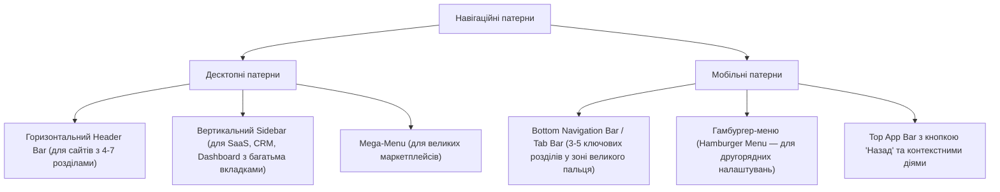
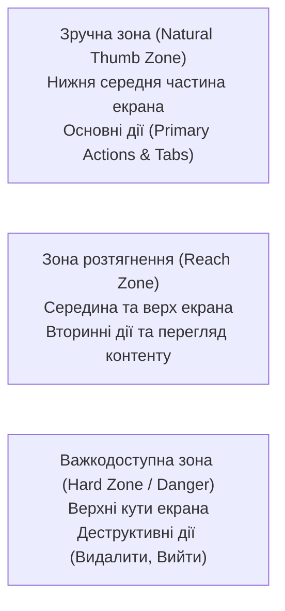

# Урок 152: Проєктування навігації

## Вступ: Навігація як скелет користувацького інтерфейсу

Навігація у цифровому продукті відіграє роль дорожньої системи та покажчиків у сучасному мегаполісі. Незалежно від того, наскільки цінний контент чи потужний функціонал закладений у застосунку, якщо користувач не може інтуїтивно зрозуміти, «де він знаходиться», «куди він може піти» та «як повернутися назад», продукт зазнає поразки.

Проєктування навігаційних систем вимагає глибокого розуміння психології орієнтування людини у просторі (Spatial Wayfinding), обмежень робочої пам'яті та адаптації під різні розміри екранів — від наручних годинників до широкоформатних моніторів.

---

## 1. Патерни глобальної та локальної навігації

У сучасному UI/UX дизайні сформувалася система перевірених патернів компонування навігації:



### 1. Десктопні патерни навігації:
- **Top Navigation Bar (Горизонтальний хедер)**: Ідеальний для простих маркетингових сайтів та e-commerce середнього масштабу. Обмежений 5–7 пунктами, щоб не перевантажувати рядок.
- **Collapsible Sidebar (Вертикальне бічне меню)**: Стандарт для професійних складних систем (Enterprise SaaS, CRM, аналітичні платформи). Легко масштабується вниз (додавання нових модулів без руйнування верстки) та підтримує дворівневу вкладеність і згортання в режим іконок.
- **Mega-Menu (Мега-меню)**: Великі двовимірні випадаючі панелі для інтернет-магазинів із тисячами категорій (Rozetka, Amazon), що дозволяють охопити поглядом всю таксономію одразу.

### 2. Мобільні патерни:
- **Bottom Navigation Bar (Нижній таб-бар)**: Золотий стандарт iOS (Human Interface Guidelines) та Android (Material Design 3). Забезпечує миттєвий перехід між 3–5 головними розділами в зоні легкої досяжності великого пальця (Thumb Zone).
- **Плаваючий гамбургер (Hamburger Drawer)**: Доцільний виключно для рідко використовуваних технічних розділів (налаштування, юридичні документи, політика конфіденційності). Ховати туди основний функціонал — прямий шлях до падіння Engagement Rate на 50%.

---

## 2. Анатомія Wayfinding: Хлібні крихти, стани фокусу та активні вкладки

Для того щоб користувач відчував повний контроль над навігаційним процесом, інтерфейс повинен відповідати на три фундаментальні питання (Three Navigation Questions за Якобом Нільсеном):

1. **«Де я знаходжуся?» (Current Location)**:
   - Активний пункт меню повинен мати виразну візуальну відмінність (контрастний колір, підкреслення, зміна ваги шрифту, бейдж).
   - Заголовок сторінки (H1) повинен дослівно збігатися з назвою натиснутого пункту меню, щоб виключити когнітивний дисонанс.
2. **«Де я вже був?» (Breadcrumbs & History)**:
   - «Хлібні крихти» обов'язкові для каталогів з глибиною вкладеності від 2 рівнів: `Головна > Електроніка > Ноутбуки > Apple`.
   - Кожен проміжний елемент крихт має бути клікабельним, а останній (поточний) — заблокованим для повторного кліку.
3. **«Куди я можу піти далі?» (Next Steps & Contextual Links)**:
   - Зрозумілі назви посилань без загальних слів «Натисніть сюди» або «Детальніше». Текст посилання має містити назву цільового об'єкта: «Переглянути технічні характеристики».

---

## 3. Ергономіка та Thumb Zone у мобільних інтерфейсах

Дослідження Стівена Хубера (Steven Hoober) щодо використання смартфонів показали, що понад 49% людей тримають телефон однією рукою, а 75% взаємодій здійснюються виключно великим пальцем.



- **Критичне правило мобільної ергономіки**: Ключові навігаційні переходи та підтвердження дій мають розташовуватися в нижній третині екрана. Верхні кути резервуються для дій повернення або системних піктограм, щоб запобігти випадковим натисканням.

---

## 4. Доступність навігації (a11y) та клавіатурне керування

Професійний дизайн навігації зобов'язаний відповідати міжнародним стандартам WCAG 2.2:
- **Skip-to-Content Link**: Спеціальне приховане посилання на початку DOM-дерева, яке стає видимим при першому натисканні клавіші `Tab`, дозволяючи незрячим користувачам або людям без миші пропустити 20 посилань хедера та одразу перейти до основного контенту сторінки.
- **Логічний порядок фокусу (Focus Order)**: Порядок переміщення клавішею Tab повинен суворо відповідати логіці читання (зліва направо, зверху вниз).
- **Виразний Focus Ring**: Індикатор активного фокусу повинен мати коефіцієнт контрастності не менше 3:1 відносно фону та не приховуватися через `outline: none` без заміни на кастомні стилі.


## Практичний інженерний розбір: Повний цикл UX-проєктування складного сценарію

Розглянемо практичний приклад проєктування сценарію повернення товару в e-commerce маркетплейсі:

```
[Користувач у списку замовлень] ──> Клік "Повернути товар"
                                           │
                                           ▼
                                 [Перевірка умов (Policy Check)]
                                 Термін < 14 днів?
                                  ├── НІ ──> [Екран пояснення причини відмови + Альтернативи]
                                  └── ТАК ──> [Вибір товарів та причин із фото]
                                                    │
                                                    ▼
                                            [Вибір способу повернення]
                                            Кур'єр / Поштомат / Відділення
                                                    │
                                                    ▼
                                            [Генерація штрих-коду ТТН]
                                                    │
                                                    ▼
                                            [Трекінг повернення коштів]
```

### Деталізація станів та точок контакту:
1. **Точка входу (Trigger)**: Кнопка у деталях замовлення з тултіпом статусу.
2. **Форма завантаження дефекту (Upload Step)**: Drag-and-drop зона для додавання 1-5 фотографій дефекту з клієнтським стисненням картинок.
3. **Підтвердження та зворотний зв'язок (Feedback)**: Відправка накладної та push-сповіщення у застосунок.


## Комплексний фреймворк проєктування сценаріїв взаємодії (UX Interaction Design)

Створення якісного цифрового продукту починається з глибокого розуміння шляху користувача, декомпозиції складних завдань та побудови логічної інформаційної архітектури:

```
[Потреби користувача та цілі бізнесу]
                   │
                   ▼
[Побудова карти завдань (Task Analysis & User Flows)]
                   │
                   ▼
[Інформаційна архітектура та навігаційна модель (IA)]
                   │
                   ▼
[Декомпозиція на основні, альтернативні та крайові сценарії]
                   │
                   ▼
[Проєктування станів інтерфейсу (Empty, Loading, Error, Success)]
                   │
                   ▼
[Прототипування та валідація на юзабіліті-тестах]
```

### Матриця станів користувацького інтерфейсу (The 5 UI States)

| Стан інтерфейсу | Опис та контекст виникнення | Типові помилки дизайну | Оптимальне інженерне рішення |
| :--- | :--- | :--- | :--- |
| **Ідеальний стан (Ideal State)**| Застосунок заповнений даними, всі блоки працюють коректно | Дизайн розрахований лише на ідеальні короткі тексти | Тестування на довгих прізвищах, різних мовах та розмірах екрану |
| **Порожній стан (Empty State)**| Користувач щойно зареєструвався, замовлень/даних ще немає | Порожній білий екран без підказок, що викликає розгубленість | Приваблива графіка, пояснення користі та кнопка заклику до дії (CTA) |
| **Стан завантаження (Loading)**| Очікування відповіді сервера або обробки важкого файлу | Блокування інтерфейсу без фідбеку або нав'язливий спиннер | Skeleton screens, мікроанімації прогресу з таймінгом |
| **Стан помилки (Error State)**| Обрив мережі, відмова API, невалідні вхідні дані | Незрозумілі повідомлення типу "Error 500" без виходу | Чітке пояснення проблеми людяною мовою + кнопка "Повторити" |
| **Частковий стан (Partial)** | Завантажилася лише частина даних (наприклад, аватар без списку) | Зламані порожні плашки або безкінечний лоадер | Graceful Degradation: показ доступної інформації + бейдж помилки блоку |


## Когнітивна психологія та інженерія поведінки користувачів у веб-інтерфейсах

Проєктування взаємодії повинно базуватися на об'єктивних законах сприйняття інформації людським мозком:

### 1. Ключові закони UX-дизайну:
- **Закон Фіттса (Fitts's Law)**: Час досягнення цілі залежить від відстані до неї та її розміру. Головні кнопки повинні бути великими та розташовуватися у зонах легкого доступу (наприклад, закріплені внизу екрана на мобільних).
- **Закон Хіка (Hick's Law)**: Час прийняття рішення зростає логарифмічно зі збільшенням кількості варіантів. Необхідно скорочувати меню вибору та розбивати складні форми на покрокові візарди.
- **Закон Якоба (Jakob's Law)**: Користувачі проводять більшість часу на інших сайтах, тому вони очікують, що ваш сайт працюватиме за знайомими патернами (кошик у правому верхньому кутку, логотип повертає на головну).

### 2. Архітектура доступності (WCAG 2.1 Principles: POUR)
- **Perceivable (Сприйнятність)**: Контрастність тексту, альтернативний текст для зображень, субтитри до відео.
- **Operable (Керованість)**: Повна доступність інтерфейсу з клавіатури без використання миші.
- **Understandable (Зрозумілість)**: Чіткі підказки до полів, передбачувана навігація, допомога у виправленні помилок.
- **Robust (Надійність)**: Сумісність із різноманітними браузерами та допоміжними технологіями (екранні диктори).


## Інженерія користувацького досвіду: Метрики успіху та валідація дизайну

Дизайн цифрового продукту повинен спиратися на вимірні кількісні та якісні показники:

### 1. Ключові продуктові метрики UX:
- **Task Success Rate (TSR)**: Відсоток користувачів, які успішно завершили цільовий сценарій.
- **Time on Task (ToT)**: Час, витрачений на проходження флоу (виявлення затримок та когнітивного перевантаження).
- **System Usability Scale (SUS)**: Стандартизована оцінка зручності системи (норма > 68 балів).

### 2. Чеклист дизайну інтерфейсу:
- [ ] Передбачено поведінку для довгих текстових рядків (Truncation, Tooltip, Wrap)
- [ ] Реалізовано зрозумілі індикатори прогресу для багатоетапних дій
- [ ] Забезпечено видимі стани активності для всіх інтерактивних компонентів


## Практичний AI-Playbook UI/UX дизайнера: Промпти для проєктування сценаріїв

Шаблони для генерації User Flows та виявлення прихованих крайових випадків:

### Промпт для декомпозиції користувацького сценарію:
```text
Дій як Lead Product Designer. Ми розробляємо функціонал [Назва функціоналу, наприклад: оформлення повернення товару].
Цільова аудиторія: [Опис персони].
Завдання:
1. Побудуй детальний User Flow від точки входу до фінального підтвердження.
2. Виділи Основний успішний шлях (Happy Path).
3. Опиши мінімум 4 альтернативних та крайових сценарії (Edge Cases: помилка оплати, таймаут сесії, відсутність товару на складі).
4. Склади матрицю необхідних екранів та станів для кожного кроку.
```


## Архітектурний шаблон enterprise-рівня: Керування дизайн-боргом та еволюція системи

Розвиток продуктового інтерфейсу вимагає балансу між швидкістю випуску фіч та підтримкою чистоти користувацького досвіду:

### 1. Управління дизайн-боргом (UX Debt Management):
- Регулярні дизайн-рев'ю кожні два тижні для виявлення накопичених візуальних невідповідностей.
- Централізований репозиторій дизайн-системи в Figma з версіонуванням бібліотек компонентів.
- Метрика чистоти інтерфейсу: відсоток екранів, що використовують стандартні компоненти без кастомних оверрайдів.

### 2. Матриця перевірки консистентності продукту:
- Єдність просторових відступів (система сітки 4px / 8px).
- Передбачуваність поведінки однакових елементів на різних платформах (Web, iOS, Android).
- Відповідність емоційного тону інтерфейсу загальній стратегії бренду компанії.


## Інженерна матриця доступності, етичного дизайну та захисту прав користувачів

Дизайн сучасного продукту нерозривно пов'язаний з дотриманням регуляторних вимог доступності та прав людини:

### 1. Відповідність Європейському акту доступності (European Accessibility Act - EAA)
- З 2025 року відповідність стандарту WCAG 2.1 AA є юридично обов'язковою для всіх цифрових продуктів у країнах ЄС. Недотримання вимог тягне за собою штрафи та блокування сервісів.
- **Антипатерни Dark Patterns**: Заборона використання маніпулятивних технік інтерфейсу (приховані платежі, складні процеси відписки, підступні галочки згоди). Дизайн зобов'язаний бути прозорим та чесним.
- **Інклюзивність та адаптивність**: Інтерфейс повинен коректно адаптуватися для користувачів із порушеннями зору, моторики, слуху та когнітивних функцій.

### 2. Чеклист етичного та доступного дизайну:
- [ ] Контрастність тексту мінімум 4.5:1 для нормального тексту та 3:1 для великих заголовків
- [ ] Зрозуміла та видима індикація фокусу для навігації з клавіатури
- [ ] Відсутність залежності сприйняття інформації виключно від кольору (наявність іконок і тексту)
- [ ] Прозорість процесів скасування підписок та видалення облікових записів


## Поглиблена інженерна практика: Масштабування дизайн-систем та Design QA

Створення узгодженого та доступного інтерфейсу вимагає тісної співпраці дизайнерів та розробників на системному рівні:

### 1. Архітектура дизайн-токенів (Design Tokens Architecture)
Дизайн-токени є єдиним джерелом правди для візуальних параметрів продукту:
- **Глобальні токени**: Абстрактні значення (наприклад, `color-blue-500: #3b82f6`, `spacing-4: 16px`).
- **Семантичні токени**: Контекстні призначення (наприклад, `color-bg-interactive: {color-blue-500}`, `color-text-danger: {color-red-600}`).
- **Компонентні токени**: Точні параметри конкретного компонента (`button-primary-bg: {color-bg-interactive}`).
- Автоматичний експорт токенів з Figma через Style Dictionary у змінні SCSS, CSS Custom Properties та Tailwind Config.

### 2. Процедура Design QA та перевірка доступності (WCAG)
Контроль реалізації дизайну у вихідному коді продукту:
- **Pixel Perfection vs Fluid Layout**: Перевірка гнучкого поводження макетів при різних роздільних здатностях екрана (Fluid Typography, Breakpoints).
- **Контрастність за WCAG 2.2**: Забезпечення співвідношення контрасту не менше 4.5:1 для звичайного тексту та 3:1 для великих заголовків та інтерактивних елементів.
- **Стани фокусу (Focus Ring)**: Обов'язкова наявність помітного індикатора фокусу для користувачів, які здійснюють навігацію з клавіатури.


## Інженерний інструментарій продуктового дизайну (Design & Prototyping Toolkit)

Сучасний UI/UX процес інтегрований у розробку через спеціалізовані платформи:
- **Tokens Studio for Figma**: Управління дизайн-токенами з прямою синхронізацією змін через GitHub Pull Requests у репозиторій фронтенду.
- **Інструменти немодерованого тестування (Maze, Lookback)**: Швидке тестування інтерактивних клікабельних прототипів на сотнях реальних користувачів для виявлення зон спотикання (Misclick rate).
- **Плагіни валідації доступності**: Stark та Axe для миттєвої перевірки контрастності, симуляції різних форм дальтонізму (дейтеранопія, протанопія) безпосередньо у робочому просторі Figma.


## Комплексний інженерний чеклист передачі дизайну (Design Handoff Gate)

Перед фінальною передачею макетів та сценаріїв команді інженерної розробки:
1. **Повнота сценаріїв (Flow Completeness)**:
   - [ ] Описано всі ключові стани інтерфейсу: Default, Hover, Active, Disabled, Loading (Skeleton), Empty State, Error State.
   - [ ] Спроєктовано нетипові та граничні випадки: довгі текстові рядки, відсутність аватарів, обрив інтернет-з'єднання.
2. **Адаптивність та дизайн-токени**:
   - [ ] Макет коректно адаптується під ключові контрольні точки (Mobile 375px, Tablet 768px, Desktop 1440px).
   - [ ] Усі кольори, шрифтові стилі, відступи та радіуси скруглення прив'язані до централізованих дизайн-токенів.
3. **Інклюзивність та доступність**:
   - [ ] Контрастність тексту відповідає мінімальному порогу 4.5:1 за стандартом WCAG 2.2 AA.
   - [ ] Розміри інтерактивних зон натискання на сенсорних екранах складають не менше 44x44 CSS-пікселів.


## Практичний інженерний кейс-стаді: Редизайн та скорочення шляху користувача (Friction Reduction)

Розглянемо кейс підвищення конверсії в мобільному додатку доставки продуктів:
1. **Виявлена проблема**: Аналітика Amplitude зафіксувала відтік 58% користувачів на етапі введення адреси доставки та вибору часового інтервалу кур'єра.
2. **Дослідження поведінки (UX Research)**: Серія глибинних інтерв'ю та аналіз теплових карт показали, що користувачі дратувалися через необхідність вручну вводити номер під'їзду, поверх та код домофону щоразу заново, а також через незручний спадний список вибору часу.
3. **Продуктове рішення**:
   - Спроєктовано механізм автоматичного збереження попередніх адрес з можливістю вибору «Дім», «Робота» в один клік.
   - Інтегровано геолокацію з автопідстановкою адреси через карти.
   - Спадний список замінено на горизонтальний скрол зручних інтерактивних чіпсів із доступними інтервалами.
   - Результат: Зростання успішного завершення замовлень (Checkout Completion Rate) на 34% вже в першому спринті після релізу.


## Продуктові метрики користувацького досвіду та моделі зрілості (UX Metrics & SUS)

Якість спроєктованого дизайну оцінюється не суб'єктивним «подобається / не подобається», а стандартизованими психометричними шкалами:
1. **System Usability Scale (SUS)**:
   - Стандартизоване опитування з 10 пунктів із 5-бальною шкалою Лайкерта.
   - Оцінка вище 68 балів вважається середньою за індустрією, понад 80.3 бали — ознака світового класу (A-Grade Usability).
2. **Операційні метрики зручності**:
   - **Task Completion Rate (TCR)**: Відсоток користувачів, які успішно завершили сценарій без допомоги.
   - **Time on Task (ToT)**: Середній час, необхідний для досягнення цілі в інтерфейсі.
   - **Single Ease Question (SEQ)**: Однопунктове оцінювання складності завдання одразу після його виконання («Наскільки легким було оформлення замовлення?») за шкалою від 1 до 7.


## Інтеграція генеративного AI у продуктовий дизайн: Синтетичні персони та дизайн-аудит

Штучний інтелект підсилює дослідницький та проєктний цикл дизайнера:
1. **Генерація реалістичного контенту замість Lorem Ipsum**: AI наповнює макети персоналізованими текстами, іменами та цінами для валідації довжини рядків у верстці.
2. **Симуляція тестування доступності**: AI-аудитор перевіряє контрастність кольорів, структуру навігації та наявність ARIA-атрибутів за стандартами WCAG 2.2.
3. **Генерація варіантів мікрокопі (UX Copywriting)**: Створення 10 альтернативних варіантів тексту для кнопок, помилок та онбордингу для A/B тестування.


## Підсумковий інженерний огляд та практичні рекомендації

Опанування теми **«Проєктування навігації»** є ключовим будівельним блоком у професійному становленні спеціаліста за напрямком **AI UI-UX Designer**. Системне застосування розглянутих методологій дозволяє:
1. **Забезпечити максимальну надійність та стабільність рішень**, спираючись на перевірені індустріальні патерни та міжнародні стандарти.
2. **Усунути людський фактор та сліпі зони**, використовуючи матриці контролю якості, автоматизовані тести та перехресну валідацію.
3. **Ефективно інтегрувати сучасні AI-інструменти** у щоденний виробничий конвеєр, виступаючи в ролі кваліфікованого інженера-архітектора, який ставить точні завдання та критично верифікує результат.
