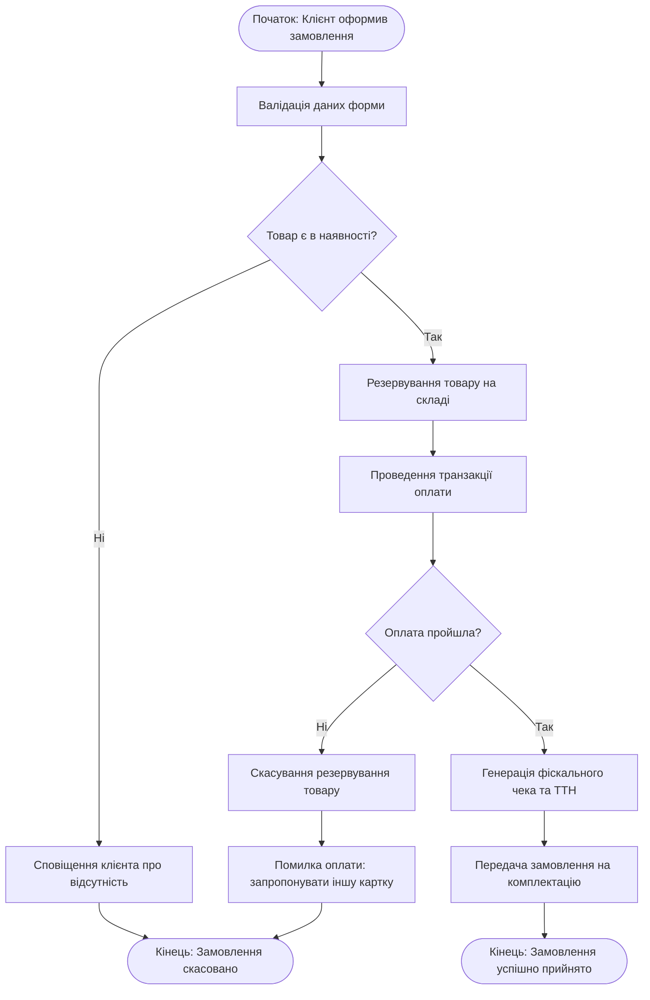

# Урок 211: Опис поточного та цільового процесу

## Вступ: Процесна трансформація бізнесу — міст між As-Is та To-Be

Будь-яка оптимізація бізнесу, цифрова трансформація чи впровадження штучного інтелекту приречені на провал, якщо компанія не розуміє, як вона функціонує в даний момент. Спроба автоматизувати хаос призводить лише до автоматизованого хаосу.

**Опис поточного (As-Is) та цільового (To-Be) процесу** — це фундаментальна методологія бізнес-аналізу, що полягає в об'єктивній фіксації реального стану операційної діяльності компанії («як є зараз»), виявленні втрат, затримок і розривів, та проектуванні оптимізованого майбутнього стану («як має бути») з урахуванням сучасних технологій та автоматизації.

Спеціаліст напрямку **AI Business Analyst** виступає архітектором цієї трансформації: він не просто документує скарги співробітників, а проводить глибокий інженерний Gap-аналіз (аналіз розривів), розраховує економічний ефект від переходу та проектує дорожню карту змін.

У цьому уроці ми вивчимо принципи фіксації моделі As-Is, методи виявлення неформальних процесів (Shadow Processes), проектування моделі To-Be, техніку Gap Analysis та використання AI для прискорення аналітичного моделювання.

---

## 1. Модель As-Is: Фіксація суворої реальності без прикрас

Модель **As-Is (Поточний стан)** описує фактичну поведінку системи на даний момент часу. 

```
┌────────────────────────────────────────────────────────────────────────┐
│                   КЛЮЧОВІ ДЖЕРЕЛА ДАНИХ ДЛЯ МОДЕЛІ AS-IS               │
├────────────────────────────────┬───────────────────────────────────────┤
│ Джерело                        │ Що дозволяє виявити                   │
├────────────────────────────────┼───────────────────────────────────────┤
│ 1. Глибинні інтерв'ю (SME)     │ Болі користувачів, неформальні домовле-│
│                                │ ності, ручні коригування даних        │
├────────────────────────────────┼───────────────────────────────────────┤
│ 2. Пряме спостереження         │ Реальні затримки, перемикання між     │
│    (Job Shadowing)             │ десятками вікон, ручне перенесення    │
├────────────────────────────────┼───────────────────────────────────────┤
│ 3. Цифровий слід (Process Mining│ Фактичні часові мітки в ERP/CRM,      │
│    Event Logs)                 │ відхилення від регламентів у 70% випадків│
└────────────────────────────────┴───────────────────────────────────────┘
```

### Пастка «Регламент замість реальності»:
Головна небезпека аналітика-початківця — переписати старі посадові інструкції 5-річної давнини. У реальному житті співробітники давно обходять незручні регламенти через приватні чати в Telegram або таблиці Excel («Тіньові процеси»). Завдання аналітика — зафіксувати **фактичний потік операцій**.

---

## 2. Аналіз розривів (Gap Analysis: As-Is -> To-Be)

Міст між поточним та цільовим станом формується за допомогою матриці аналізу розривів:

```
                      [ Поточний процес As-Is ]
                       • 12 ручних кроків
                       • 4 дні на погодження
                       • 18% помилок введення
                                  │
                       [ GAP ANALYSIS (Розрив) ]
                       • Відсутність API-інтеграції
                       • Ручний підпис документів
                       • Дублювання обов'язків
                                  │
                                  ▼
                      [ Цільовий процес To-Be ]
                       • 3 автоматизовані кроки
                       • 15 хвилин виконання
                       • 0.1% помилок завдяки AI
```

### 4 виміри трансформації (POPT Model):
1. **People (Люди)**: Перерозподіл ролей, навчання роботі з новими інструментами, ліквідація рутинних операцій.
2. **Organization (Організація)**: Зміна політик погодження, нові метрики KPI, скорочення ієрархічних ланок.
3. **Process (Процес)**: Ліквідація зайвих петель узгодження (Lean Waste Elimination), стандартизація шляхів.
4. **Technology (Технології)**: Впровадження API, систем електронного документообігу та AI-асистентів.

---

## 3. Модель To-Be: Проектування оптимізованого майбутнього

Модель **To-Be (Цільовий стан)** — це не просто «ідеальна мрія», а реалістичний інженерний план:
- Враховує технологічні обмеження існуючих корпоративних систем.
- Мінімізує кількість точок передачі відповідальності між відділами (Handoffs), які є головним джерелом затримок.
- Впроваджує автоматичні бізнес-правила (Business Rules Engine) замість людських погоджень для низькоризикових операцій.

---

## 4. Використання AI в процесному аналізі

AI радикально скорочує час на рутинну роботу аналітика:
- **Транскрибація та екстракція процесів з інтерв'ю**: Аудіозапис бесіди з операційним директором перетворюється моделлю на список кроків, ролей та систем.
- **Генерація порівняльних таблиць Gap Analysis**: AI зіставляє опис As-Is з цілями проекту та формує матрицю розривів.
- **Детекція аномалій**: Пошук зайвих кроків погодження та дублювання функціоналу в текстових описах регламентів.


## Практичний інженерний розбір: Моделювання процесу обробки замовлення в нотації BPMN 2.0

Розглянемо практичний приклад моделювання та оптимізації процесу B2B-замовлень: перехід від заплутаного стану As-Is до повністю автоматизованого To-Be:

### 1. Текстова схема та розподіл за доріжками (Swimlanes)

```
┌─────────────────┬────────────────────────────────────────────────────────────────────────────────────────┐
│ Доріжка (Lane)  │ Послідовність операцій та подій процесу                                                 │
├─────────────────┼────────────────────────────────────────────────────────────────────────────────────────┤
│ Клієнт          │ [Старт: Натиснув "Оформити"] ──> [Ввів реквізити] ──> [Отримав повідомлення про статус]│
├─────────────────┼────────────────────────────────────────────────────────────────────────────────────────┤
│ API Gateway     │ [Валідація запиту та JWT] ──> [Маршрутизація до Order Service]                         │
├─────────────────┼────────────────────────────────────────────────────────────────────────────────────────┤
│ Order Service   │ [Перевірка наявності на складі] ──> {Шлюз XOR: Товар є?}                               │
│                 │   ├── НІ  ──> [Повернення помилки "Товар відсутній"] ──> [Кінець: Відхилено]           │
│                 │   └── ТАК ──> [Резервування залишку] ──> [Запит на оплату до Payment Service]           │
├─────────────────┼────────────────────────────────────────────────────────────────────────────────────────┤
│ Payment Service │ [Списання коштів через шлюз] ──> {Шлюз XOR: Успішно?}                                  │
│                 │   ├── НІ  ──> [Скасування резерву] ──> [Кінець: Помилка оплати]                        │
│                 │   └── ТАК ──> [Фіксація статусу 'PAID'] ──> [Публікація події в Kafka] ──> [Кінець: ОК]│
└─────────────────┴────────────────────────────────────────────────────────────────────────────────────────┘
```

### 2. Діаграма процесу у синтаксисі Mermaid (BPMN Workflow)



## Моделювання бізнес-процесів: Від діагностики As-Is до проектування ефективного To-Be

Бізнес-аналітик виступає архітектором операційної діяльності, формалізуючи неструктуровані процеси компанії у строгі графічні моделі за міжнародними стандартами:

```
[Ідентифікація процесу та його бізнес-цілей]
                     │
                     ▼
[Визначення меж процесу (SIPOC: Suppliers, Inputs, Process, Outputs, Customers)]
                     │
                     ▼
[Збір інформації через інтерв'ю та воркшопи з стейкхолдерами]
                     │
                     ▼
[Моделювання поточного стану (As-Is Process Map)]
                     │
                     ▼
[Аналіз вузьких місць: втрати часу (Muda), дублювання функцій, ручна праця]
                     │
                     ▼
[Проектування оптимізованого стану (To-Be Process) з використанням BPMN 2.0]
                     │
                     ▼
[Формування функціональних вимог для інженерної команди на автоматизацію]
```

### Комплексна інженерна матриця моделювання та оптимізації процесів

| Елемент процесу | Семантика в нотації BPMN 2.0 | Питання для аналізу | Критерії якості моделі |
| :--- | :--- | :--- | :--- |
| **Подія (Event)** | Круг (Start / Intermediate / End). Показує, ЩО сталося ініціатором чи результатом | Який тригер запускає процес? Які часові обмеження? | Чітка наявність початкової та хоча б однієї кінцевої події |
| **Активність (Task/Activity)** | Прямокутник із закругленими кутами. Дія, яку виконує людина або система | Хто виконавець? Чи можна цю дію автоматизувати через AI/API? | Формулювання за правилом «Дієслово + Іменник» (напр., «Перевірити платіж») |
| **Шлюз (Gateway)** | Ромб (Exclusive XOR, Parallel AND, Inclusive OR). Розгалуження потоку управління | Які умови переходу? Чи можливі паралельні гілки? | Кожен вихідний потік шлюзу XOR повинен мати чітку бізнес-умову |
| **Доріжки (Lanes / Pools)** | Горизонтальні або вертикальні зони відповідальності ролей чи систем | Хто відповідає за конкретний крок? Де межа між клієнтом і сервером? | Процес не повинен містити "підвішених" дій без відповідального виконавця |

### Методологія усунення втрат за принципами Lean / Kaizen:
1. **Надмірна обробка (Over-processing)**: Вимагання від користувача заповнювати 20 полів реєстрації, якщо для надання послуги достатньо email та імені.
2. **Очікування (Waiting)**: Ручне погодження рахунків бухгалтером, яке займає 48 годин, замість автоматичної перевірки за лімітом суми через бізнес-правило.
3. **Дефекти та повторна робота (Rework)**: Повернення документів через помилки валідації на пізніх стадіях через відсутність миттєвих підказок на формі вводу.


## Стандарти моделювання бізнес-процесів за специфікацією OMG BPMN 2.0

Формалізація бізнес-процесів вимагає дотримання офіційного стандарту Object Management Group (OMG):
1. **BPMN 2.0.2 (Business Process Model and Notation)**:
   - Суворе дотримання правил топології: потоки управління (Sequence Flows) не можуть перетинати межі пулів (Pools). Для зв'язку між різними організаціями чи незалежними системами використовуються виключно потоки повідомлень (Message Flows).
   - Однозначність шлюзів: заборонено використовувати ромби без зазначення типу (XOR, AND, OR) або залишати вихідні гілки шлюзу без підписаних умов переходу.
2. **BABOK Guide v3 (A Guide to the Business Analysis Body of Knowledge)**:
   - Комплексний аналіз вимог: бізнес-вимоги транслюються у функціональні специфікації з обов'язковим визначенням критеріїв успіху процесу (KPIs).


## Інженерний AI-плейбук: Автоматизоване моделювання та аналіз процесів

AI як помічник бізнес-аналітика:
1. **Синтез BPMN діаграми з неструктурованого інтерв'ю**:
   ```text
   Роль: Lead Business Process Architect.
   Завдання: Проаналізуй стенограму інтерв'ю з керівником відділу логістики та згенеруй валідну діаграму BPMN 2.0 у форматі Mermaid.js.
   Вимоги: Виділи доріжки (Lanes), визнач початкову та кінцеву події, підпиши всі умови на шлюзах XOR.
   ```


## Архітектурний конвеєр управління вимогами та моделями процесів

Синхронізація бізнес-моделей із системними специфікаціями:

```
[Стратегічні бізнес-цілі компанії] ──> [Карта процесів верхнього рівня (SIPOC)]
                                                    │
                                                    ▼
                                     [Детальні моделі процесів BPMN 2.0]
                                                    │
                                                    ▼
                                     [Функціональні вимоги та User Stories у Jira]
                                                    │
                                                    ▼
                                     [Матриця простежуваності вимог (RTM)]
```


## Відповідність регуляторним нормам при моделюванні процесів (Compliance by Design)

Врахування законодавчих вимог при зміні бізнес-процесів:
- **Право на забуття (Right to be Forgotten - GDPR)**: Процес повинен передбачати автоматизований потік видалення або анонімізації персональних даних клієнта за його запитом протягом 30 календарних днів.
- **Аудиторський слід (Audit Trail)**: Кожна фінансова дія, зміна статусу або редагування договору повинна логуватися із зазначенням ID користувача, таймстепу та старого/нового значення.


## Індустріальний досвід: Оптимізація ланцюгів постачання в Toyota та Amazon

Практичне застосування методів Lean:
- **Toyota Production System (TPS)**: Безперервне виявлення та усунення 7 видів виробничих втрат (Muda), що трансформувалося у методологію Lean IT та Agile бізнес-аналіз.


## Інструментарій бізнес-аналітика (Business Analyst Toolkit)

Програми для моделювання та управління вимогами:
- **Моделювання процесів**: Camunda Modeler, Signavio, Miro, Lucidchart, Bizagi.
- **Управління вимогами**: Atlassian Jira, Confluence, Enterprise Architect.


## Підсумковий чеклист валідації моделі бізнес-процесу (BPMN Quality Checklist)

Критерії затвердження моделі процесу:
- [ ] Процес має чітку початкову подію, кінцеву подію та визначені межі (Scope).
- [ ] Кожна дія призначена на конкретну доріжку (Lane) відповідального виконавця або системи.
- [ ] Всі вихідні потоки шлюзів XOR мають однозначні взаємовиключні умови.
- [ ] Модель узгоджена з ключовими стейкхолдерами та командою розробки.


## Експертний аналіз: Як усунення "вузького місця" в ручному погодженні скоротило час обробки кредиту з 3 днів до 4 хвилин

Кейс реінжинірингу бізнес-процесу банку:
1. **Стан As-Is**: Заявка на кредит проходила 5 послідовних ручних погоджень (кредитний інспектор, служба безпеки, юрист, ризик-менеджер, керівник відділення). Середній час рішення складав 72 години.
2. **Аналіз вузьких місць**: 85% часу заявка просто лежала в черзі в очікуванні перевірки. При цьому 90% заявок до 50 000 грн мали стандартний позитивний профіль.
3. **Стан To-Be**: Впровадження автоматизованого скорингу через API бюро кредитних історій для заявок до 50 000 грн. Ручне погодження залишено лише для сумнівних випадків. Час прийняття рішення скоротився до 4 хвилин, а операційні витрати банку знизилися на 60%.


## Метрики оптимізації та ефективності бізнес-процесів

Показники операційної досконалості:
- **Process Cycle Time**: Загальний час від запуску процесу до отримання фінального результату клієнтом.
- **Process Cycle Efficiency (PCE)**: Співвідношення часу створення цінності (Value-Added Time) до загального часу процесу (Lead Time).
- **Rework Rate**: Відсоток заявок чи документів, які повертаються на доопрацювання через помилки валідації або неповноту даних.


## Діалоговий воркфлоу аналітика: Пошук протиріч у бізнес-правилах

Валідація логіки процесу:
1. **Крок 1**:
   > *BA*: «Ось 6 бізнес-правил нарахування кешбеку для різних категорій карток. Знайди потенційні логічні конфлікти, коли одна й та сама покупка може потрапити під дві взаємовиключні умови».


## Системний синтез та стратегічний аналіз підприємства

Бізнес-аналітик формує операційний ландшафт компанії:
- **Enterprise Architecture**: Зв'язок бізнес-процесів із корпоративною IT-інфраструктурою через стандарти TOGAF та ArchiMate.
- **Process Mining**: Використання логів інформаційних систем (Celonis, UiPath) для автоматичного відновлення реального проходження процесів та виявлення прихованих втрат.


## Поглиблений інженерний гайд: Аналіз кореневих причин (Root Cause Analysis) у бізнес-процесах

Виявлення справжніх джерел неефективності за допомогою аналітичних фреймворків:
1. **Діаграма Ішікави (Fishbone Diagram / Причинно-наслідкова діаграма)**:
   Структурування факторів за 6 категоріями (6M): Люди (Manpower), Методи (Methods), Машини/Системи (Machines), Матеріали/Дані (Materials), Вимірювання (Measurement), Середовище (Milieu).
2. **Метод "5 Чому" (5 Whys)**:
   Послідовне заглиблення у проблему шляхом 5-кратного питання "Чому це сталося?", що дозволяє перейти від поверхового симптому (наприклад, "Клієнт отримав замовлення із запізненням") до системного організаційного дефекту ("Відсутнє автоматичне сповіщення про зміну адреси доставки в CRM").


## Виявлення прихованих дефектів бізнес-логіки та нестиковок процесів

Методологія запобігання помилкам до старту розробки:
- **Аналіз прогалин (Gap Analysis)**:
  - Порівняння вимог нормативних регуляторів із поточною реалізацією процесів.
- **Перевірка на повноту умов (Truth Table / Decision Table)**:
  - Побудова таблиць рішень для систем зі складними правилами знижок, страхування чи податків. Якщо система має 4 булеві параметри, таблиця повинна мати $2^4 = 16$ комбінацій, гарантуючи, що жоден крайовий випадок не залишився без чіткого бізнес-правила.


## Управління змінами та моніторинг ефективності процесів (Process Governance)

Забезпечення безперервного покращення операційної діяльності:
- **Управління змінами (Change Management / ADKAR Model)**:
  Підготовка співробітників компанії до впровадження нових процесів та IT-систем (Awareness, Desire, Knowledge, Ability, Reinforcement) для усунення внутрішнього саботажу.
- **Операційні інформаційні панелі (Process Performance Dashboards)**:
  Налаштування автоматичних дашбордів моніторингу часу проходження замовлень крізь усі підрозділи в режимі реального часу з генерацією сповіщень при перевищенні нормативів SLA.


## Симуляція аналізу розривів (As-Is / To-Be Gap Analysis) та мапування процесів

Аналітична трансформація процесів вимагає детального співставлення поточної та майбутньої моделі функціонування компанії:

### 1. Метод матриці розривів (Gap Matrix)
Аналітик фіксує кожен операційний крок за 4 векторами:
1. **Люди (People)**: Які ролі виконують операцію вручну в моделі «As-Is», і як змінюються їхні обов'язки в «To-Be» (перехід від ручного введення даних до верифікації висновків AI).
2. **Процес (Process)**: Які непотрібні кроки погодження видаляються (Lean Waste Elimination).
3. **Технології (Technology)**: Які інтеграційні шлюзи API та мікросервіси автоматизують передачу даних між ERP та CRM без залучення людини.
4. **Дані (Data)**: Які нові сутності та валідаційні схеми необхідні для підтримки нової логіки.

### 2. Моделювання виняткових ситуацій (Exception Sub-processes у BPMN)
Справжня зрілість аналітичної моделі виявляється не в описі «Happy Path», а у вичерпній деталізації компенсаційних дій: що відбувається, якщо банківський шлюз завис, якщо товару не виявилося на складі в момент комплектації, або якщо клієнт скасував замовлення на етапі доставки.


## Матриця виявлення та усунення неефективності процесів (BPM Waste Matrix)

| Джерело неефективності | Ознака в поточному процесі | Як це виглядає у схемі As-Is | Як оптимізувати у моделі To-Be |
| :--- | :--- | :--- | :--- |
| **Зайве багаторазове погодження** | Затримка затвердження рахунку на 5 днів через чергу керівників | Ланцюжок із 4 послідовних шлюзів «Погодження директором» | Автоматичне погодження рахунків до 10 000 грн за правилом бізнес-логіки без людини |
| **Ручне дублювання даних (Swivel Chair Data Entry)** | Менеджер копіює замовлення з пошти в CRM, а потім вручну в 1C | Дві операції «Ввести дані» у різних системах для одного замовлення | Налаштування прямої інтеграції через Webhook / REST API між CRM та ERP |
| **Вузьке місце (Process Bottleneck)** | Черга завдань накопичується перед одним спеціалістом | Десятки стрілок входять в одну дію, середня черга очікування перевищує 48 годин | Розподіл навантаження через чергу завдань (Round-Robin) або використання AI для автоматичної обробки типових заявок |


## Підсумковий інженерний огляд та практичні рекомендації

Опанування теми **«Опис поточного та цільового процесу»** є ключовим будівельним блоком у професійному становленні спеціаліста за напрямком **AI Business Analyst**. Системне застосування розглянутих методологій дозволяє:
1. **Забезпечити максимальну надійність та стабільність рішень**, спираючись на перевірені індустріальні патерни, міжнародні стандарти та строгі специфікації.
2. **Усунути людський фактор та сліпі зони**, використовуючи матриці контролю якості, автоматизовані тести та перехресну валідацію схем і процесів.
3. **Ефективно інтегрувати сучасні AI-інструменти** у щоденний виробничий конвеєр, виступаючи в ролі кваліфікованого інженера-архітектора, який ставить точні технічні завдання та критично верифікує результат.
