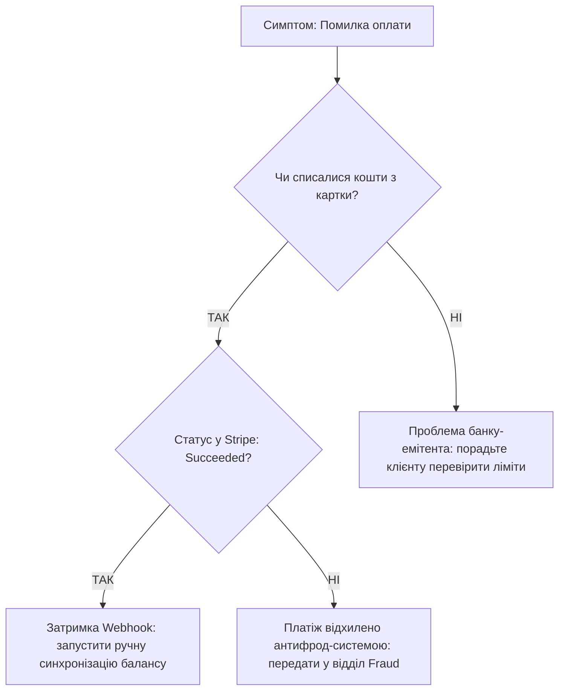

# Урок 207: Побудова troubleshooting tree

## Вступ: Інженерний підхід до вирішення інцидентів через дерева діагностики

Коли служба підтримки стикається зі сотнями різноманітних звернень щодня, хаотичні спроби вирішення проблем «методом тику» призводять до виснаження персоналу, порушення нормативів SLA та невдоволення клієнтів.

**Troubleshooting Tree (Дерево пошуку та усунення несправностей)** — це алгоритмічний граф діагностичних рішень, який на кожному вузлі ставить одне однозначне запитання з бінарними або дискретними варіантами відповіді (Так/Ні, Код помилки), послідовно відсікаючи хибні гіпотези та приводячи оператора до єдиного правильного рішення або точки ескалації.

У цьому уроці ми вивчимо принципи побудови діагностичних дерев, методику бінарного пошуку в просторі несправностей, формалізацію дерев у Mermaid та автоматизацію навігації деревами за допомогою інтерактивних AI-ботів.

---

## 1. Анатомія та правила побудови діагностичного дерева

Ефективне дерево пошуку несправностей будується за законами дискретної математики та теорії графів:

```
                      [ Початок: Клієнт не може увійти ]
                                      │
                   Чи відображається помилка на екрані?
                                 /                                      [ ТАК ]        [ НІ ]
                              │               │
                     Помилка «401»?       Білий екран?
                     /          \          /                       [ ТАК ]        [ НІ ]   [ ТАК ]     [ НІ ]
                 │              │        │           │
            Невірний      Помилка «429»? Очистити  Перевірити
             пароль         /        \   кеш браузера плагіни
                       [ ТАК ]     [ НІ ]
                         │           │
                    Rate Limit    Ескалація
                    блокування      на L2
```

### Закони ефективного дерева:
1. **Принцип максимальної ентропії (Halving / Binary Search)**:
   Кожне запитання перших рівнів повинно відсікати приблизно 50% можливих причин (наприклад: «Проблема тільки на мобільному чи й на десктопі?» відсікає половину клієнтських платформ).
2. **Перевірка найдешевших гіпотез спочатку (Cost-to-Test Rule)**:
   Спочатку перевіряються речі, які перевіряються за 5 секунд (Чи увімкнено інтернет? Чи правильний URL?), і лише потім — дорогі та тривалі операції (переінсталяція бази даних, генерація нових сертифікатів).
3. **Вичерпність кінцевих листків (Leaf Completeness)**:
   Кожна гілка дерева зобов'язана завершуватися або вирішенням проблеми (Resolution Action), або точною інструкцією щодо ескалації (Escalate to Team X with Data Y). Тупикових гілок бути не може!

---

## 2. Моделювання діагностичних дерев у коді та Mermaid

Стандартом збереження та візуалізації дерев є діаграми `flowchart TD` у Markdown:



---

## 3. Динамічні AI Troubleshooting Trees

Сучасна підтримка замінює статичні PDF-довідники динамічними AI-асистентами:
- Модель знає повний граф діагностики у вигляді векторної бази або JSON-схеми.
- Замість читання дерева людина-оператор бачить лише поточне рекомендоване запитання та кнопки відповідей.
- На основі відповідей клієнта AI миттєво веде оператора найкоротшим маршрутом до ліквідації дефекту.


## Практичний інженерний розбір: Діагностичне дерево (Troubleshooting Tree) та розбір інциденту

Розглянемо практичний алгоритм інженерної діагностики критичної проблеми "Клієнт не може завершити оплату замовлення в інтернет-магазині":

### 1. Алгоритмічне дерево локалізації несправності (Troubleshooting Decision Tree)

```
[Повідомлення клієнта: "Не проходить платіж, вибиває помилку"]
                               │
                               ▼
            [Крок 1: Збір первинного контексту (5W1H)]
            - Яка точна помилка на екрані (текст / код)?
            - Який спосіб оплати обрано (Card, Apple Pay, Google Pay)?
            - Пристрій та браузер клієнта?
            - Точний час спроби транзакції?
                               │
                               ▼
        [Крок 2: Перевірка глобального статусу систем (Status Page)]
        Чи є активний інцидент платіжного шлюзу (Stripe / LiqPay)?
          ├── ТАК ──> [Сценарій A: Інформування про відомий збій]
          │            Повідомити клієнта за скриптом + вказати термін відновлення
          └── НІ  ──> [Крок 3: Пошук у логах бекенду за Email/User ID]
                               │
                               ▼
                  [Крок 4: Аналіз HTTP статус-коду в логах]
                    │
                    ├── 400 / 422: Помилка валідації форми
                    │   └── Причина: Некоректний формат CVV або термін дії карти.
                    │       Дія: Порадити клієнту перевірити введені дані карти.
                    │
                    ├── 402 Payment Required: Відхилено банком-емітентом
                    │   └── Причина: Недостатньо коштів або встановлено інтернет-ліміт.
                    │       Дія: Порадити перевірити ліміти у мобільному банкінгу.
                    │
                    ├── 401 / 403: Помилка авторизації сесії
                    │   └── Причина: Прострочена сесія токена в кошику.
                    │       Дія: Порадити перезайти в обліковий запис або оновити сторінку.
                    │
                    └── 500 / 502 / 504: Збій сервера або тайм-аут
                        └── Причина: Внутрішній дефект платіжного мікросервісу.
                            Дія: Негайне відкриття баг-тікета в Jira з прикріпленням логу.
```

### 2. Зразок оформлення баг-репорту для чергового інженера (Escalation Ticket)
```text
Title: [P1 Incident] 504 Gateway Timeout при спробі виклику платіжного шлюзу LiqPay
User ID: usr_49821
Timestamp: 2026-10-26 10:45:12 UTC
Correlation-ID: req_c82fa19e-41a2-4a0e-bc21

Log Snippet:
[ERROR] 2026-10-26T10:45:12.102Z - PaymentProcessor - External gateway failed to respond within 15000ms.
Request: POST https://api.gateway.com/checkout/pay | Status: 504 Gateway Timeout
Response Body: {"error": "upstream_timeout", "detail": "Provider connection reset"}

Steps to Reproduce:
1. Авторизуватись під тестовим користувачем.
2. Додати будь-який товар у кошик.
3. Натиснути 'Сплатити карткою'.
Expected Result: Перенаправлення на 3D-Secure перевірку банку.
Actual Result: Користувач бачить тост "Сервер тимчасово недоступний", у консолі 504.
```


## Системна діагностика та інженерний траблшутінг у службі технічної підтримки

Сучасний спеціаліст підтримки — це перша лінія інженерної експертизи, яка локалізує проблему, ізолює дефекти від помилок конфігурації та забезпечує бездоганну комунікацію:

```
[Надходження звернення від користувача]
                   │
                   ▼
[Збір симптомів: 5W1H (Who, What, Where, When, Why, How)]
                   │
                   ▼
[Аналіз середовища: пристрій, ОС, браузер, версія додатка, ID сесії]
                   │
                   ▼
[Перевірка діагностичного дерева (Troubleshooting Tree)]
   ├── Відома проблема (Known Issue / Active Outage)?
   │     ├── ТАК ──> Надання готового Workaround + прив'язка до основного інциденту
   │     └── НІ  ──> Перехід до поглибленої діагностики
                   │
                   ▼
[Аналіз первинних артефактів: логи помилок, скріншоти, HTTP-статуси]
                   │
                   ▼
[Ізоляція проблеми: клієнтська частина, мережа чи бекенд-інцидент]
                   │
                   ▼
[Складання технічного запиту на ескалацію (Bug Escalation Report) для L2/L3/QA]
```

### Комплексна інженерна матриця діагностики та класифікації проблем

| Рівень інциденту | Симптоми та прояви | Першочергові дії спеціаліста | Артефакти для збору |
| :--- | :--- | :--- | :--- |
| **L1: Помилка користувача / Конфігурація** | Помилки валідації 400 Bad Request, забутий пароль, кеш браузера | Покрокова інструкція користувачу, скидання кешу, перевірка прав у CRM | Скріншот кроків користувача |
| **L2: Помилка інтеграції / Мережа** | Помилки 401 Unauthorized, 403 Forbidden, 429 Too Many Requests | Перевірка статусу токена, лімітів тарифного плану, налаштувань CORS | Request ID, Correlation Token, таймстемп |
| **L3: Системний дефект / Збій сервера** | Помилки 500 Internal Server Error, 502 Bad Gateway, 504 Gateway Timeout | Перевірка Status Page, відкриття P1/P2 інциденту, інформування Tech Lead | Server Error Log, HAR-файл, Stack Trace |
| **Відомий дефект (Known Workaround)** | Описаний у внутрішній базі знань дефект із тимчасовим рішенням | Застосування схваленого обхідного шляху без ескалації розробникам | Посилання на номер задачі в Jira (наприклад, BUG-4521) |

### Протокол формулювання бездоганних діагностичних питань:
1. **Відкриті запитання на старті**: «Опишіть, будь ласка, що саме відбулося після натискання кнопки оплати?» замість «У вас завис екран?».
2. **Усунення технічного жаргону**: Спілкування мовою клієнта, не вимагаючи знань про «HTTP payload» чи «DevTools Console», а пояснюючи: «Будь ласка, зробіть скріншот червоного повідомлення внизу екрану».
3. **Фіксація часових меж**: «О котрій годині ви востаннє бачили цей файл?» для точної кореляції з серверними логами.


## Стандарти обслуговування, SLA та інженерного траблшутінгу в Enterprise

Підтримка клієнтів функціонує за строго регламентованими процесами контролю якості:
1. **Метрики угоди про рівень обслуговування (Service Level Agreement - SLA)**:
   - **First Response Time (FRT)**: Час першої відповіді для критичних інцидентів (P1) < 15 хвилин; для P2 < 1 години.
   - **Mean Time to Resolution (MTTR)**: Середній час повного вирішення або надання обхідного шляху (Workaround).
   - **Customer Satisfaction Score (CSAT)**: Цільовий рівень задоволеності клієнтів >= 92%.
2. **ITIL v4 Service Desk Framework**:
   - Чітке розмежування категорій: Incident (незаплановане переривання або зниження якості сервісу) vs Problem (коренева причина повторюваних інцидентів) vs Service Request (запит на надання доступу або консультацію).


## Інженерний AI-плейбук: Аналіз логів та генерація шаблонів відповідей

Підтримка спеціаліста при розборі складних технічних запитів:
1. **Розшифровка складних логів помилок для клієнта**:
   ```text
   Роль: Senior Technical Support Engineer.
   Завдання: Переклади технічний стек-трейс та лог помилки сервера зрозумілою для нетехнічного клієнта мовою. Надай чіткі покрокові інструкції щодо усунення проблеми з його боку.
   ```


## Архітектура омніканального сервіс-деску та системи обробки інцидентів

Потік маршрутизації та ескалації звернень:

```
[Користувач: Чат, Email, Телефон] ──> [Omnichannel CRM (Zendesk / HelpScout)]
                                                    │
                                                    ▼
                                     [AI-класифікатор тематики та тональності]
                                                    │
                                                    ▼
                                     [Розподіл на спеціаліста першої лінії L1]
                                                    │
                                                    ├── Проблема вирішена?
                                                    │     └── ТАК ──> [Закриття тікета + CSAT опитування]
                                                    └── НІ  ──> [Ескалація на L2 / Jira Bug Ticket]
```


## Протокол безпеки та захист персональних даних у службі підтримки

Правила взаємодії з клієнтами при вирішенні технічних проблем:
- **Сувора заборона запиту повних паролів**: Спеціаліст підтримки ніколи не має права запитувати повний пароль користувача, CVV-код карти чи одноразовий SMS-код підтвердження.
- **Верифікація особи клієнта**: Обов'язкова попередня ідентифікація користувача за контрольними питаннями або через відправку пуш-сповіщення у мобільний додаток перед внесенням змін до облікового запису.


## Індустріальний досвід: Рівні підтримки та автоматизація в Amazon AWS

Як підтримувати мільйони користувачів без втрати якості:
- **Багаторівнева підтримка (Tier 1-3)**: Миттєва автоматична діагностика статусу інфраструктури клієнта при відкритті тікета, що дає інженеру 80% контексту ще до першого повідомлення.


## Інструментарій спеціаліста технічної підтримки (Support Toolkit)

Системи управління зверненнями та аналізу:
- **CRM та тікет-системи**: Zendesk, HelpScout, Jira Service Management, Intercom.
- **Аналіз логів та метрик**: Kibana (ELK Stack), Datadog, Grafana Loki, Sentry.
- **Діагностика мережі**: ping, traceroute, dig, nslookup, mtr, Network tab DevTools.


## Підсумковий чеклист інженерного розбору звернення (Support Triage Checklist)

Критерії якісного закриття інциденту:
- [ ] Зібрано повний контекст: ID користувача, точний час, скріншот помилки, браузер/ОС.
- [ ] Проведено перевірку за деревом несправностей та ідентифіковано відомі проблеми.
- [ ] У разі нового дефекту: оформлено баг-тікет з логами сервера та Request ID.
- [ ] Клієнту надано зрозумілу, ввічливу та вичерпну відповідь без технічного сленгу.


## Експертний аналіз: Як правильний збір симптомів допоміг зупинити глобальну атаку на DNS

Кейс із практики L1/L2 підтримки:
1. **Ситуація**: Десятки клієнтів із одного регіону почали скаржитися на неможливість зайти на сайт, тоді як у внутрішніх моніторингів усі сервери горіли зеленим.
2. **Дії спеціаліста**: Замість стандартної відписки "Очистіть кеш", оператор підтримки попросив клієнта запустити команду `nslookup api.company.com` та надіслати скріншот.
3. **Результат**: Виявлено підміну DNS-записів на рівні регіонального провайдера (DNS Poisoning). Служба безпеки своєчасно підключила Anycast захист та запобігла масштабному витоку облікових даних.


## Ключові показники ефективності служби технічної підтримки

Операційні метрики оцінки роботи спеціаліста:
- **First Contact Resolution (FCR)**: Відсоток проблем, вирішених під час першого звернення без додаткових ітерацій чи ескалацій (цільове: > 75%).
- **Average Handle Time (AHT)**: Середній час роботи над одним зверненням із урахуванням діагностики та оформлення тікета.
- **Customer Effort Score (CES)**: Оцінка того, наскільки легко клієнту було отримати допомогу.


## Діалоговий воркфлоу спеціаліста підтримки: Підготовка антикризової комунікації

Комунікація під час інцидентів:
1. **Крок 1**:
   > *Support*: «У нас впав платіжний шлюз на 2 години. Склади шаблон персоналізованого листа клієнтам, чиї платежі підвисли, з вибаченням, поясненням ситуації та наданням промокоду на знижку 20%».


## Системний синтез та кар'єрна еволюція спеціаліста підтримки

Глибокі технічні знання перетворюють оператора підтримки на технічного консультанта чи менеджера продукту:
- **Product Feedback Loop**: Систематизація болю користувачів та вплив на беклог розробки нових функцій.
- **Автоматизація першої лінії**: Створення та навчання інтелектуальних AI-агентів підтримки на базі накопиченої бази знань.


## Поглиблений інженерний гайд: Протокол взаємодії підтримки з командою Incident Response

Дії спеціаліста першої та другої ліній під час виникнення критичного системного збою (Major Incident / P1 Outage):
1. **Перші 5 хвилин**:
   - Перевірка систем моніторингу (Datadog, StatusPage).
   - Підтвердження масового характеру проблеми (>= 5 схожих звернень від різних клієнтів протягом 3 хвилин).
2. **Перші 15 хвилин**:
   - Активація внутрішнього каналу інциденту в Slack (`#incident-p1-outage`).
   - Публікація попереднього статусу на публічній Status Page: *«Investigating: We are currently experiencing issues with payment processing. Our engineering team is investigating.»*.
   - Увімкнення авто-відповідача в тікет-системі для зниження навантаження на операторів.
3. **Після ліквідації збою (Post-Incident)**:
   - Масова розсилка підтвердження відновлення роботи сервісу.
   - Участь у Post-Mortem мітингу для надання статистики звернень та зворотного зв'язку клієнтів.


## Розслідування складних інцидентів та взаємодія з розробниками

Як перетворити незрозумілу скаргу на точний баг-тікет:
- **Синдром "У мене нічого не працює"**:
  - Клієнт надає мінімум інформації в стані стресу.
  - *Дії спеціаліста*: Пошук сесії користувача у системі сесійного запису (FullStory, Smartlook, LogRocket) для перегляду точних дій клієнта за 2 хвилини до збою без зайвих опитувань.


## Управління знаннями та самообслуговування (Customer Self-Service)

Оптимізація роботи підтримки шляхом надання користувачам інструментів самостійного вирішення проблем:
- **Розвиток бази знань (Knowledge-Centered Service - KCS)**:
  Кожне нове вирішене нестандартне звернення перетворюється спеціалістом на коротку статтю бази знань із тегами симптомів, скорочуючи час повторної діагностики іншими операторами.
- **Інтелектуальні діагностичні боти**:
  Налаштування інтерактивних квізів самообслуговування на сайті, які за 3 запитання допомагають користувачу вирішити типову проблему (скидання пароля, налаштування пошти, перевірка статусу замовлення) без залучення живої людини.


## Симуляція ескалації інцидентів та взаємодії рівнів підтримки (Multi-Tier Incident Escalation)

Усунення складних технічних інцидентів вимагає бездоганної координації між рівнями сервісу з дотриманням SLA:

### 1. Трьохрівнева модель ескалації (L1 -> L2 -> L3)
- **L1 (Перша лінія)**: Прийом звернення, первинна фільтрація, верифікація особи користувача, застосування стандартних інструкцій (SOP) та базових дерев діагностики.
- **L2 (Технічна підтримка / AI Operator)**: Глибокий аналіз логів, читання відповідей API, відтворення дефекту в тестовому середовищі, перевірка бази відомих проблем.
- **L3 (Інженерна команда / DevOps / R&D)**: Аналіз вихідного коду, випуск термінового виправлення (Hotfix), усунення збоїв інфраструктури.

### 2. Процедура передачі тікета на розробників (Quality Bug Handoff)
Спеціаліст підтримки не просто передає скаргу «кнопка не працює», а формує вичерпний інженерний баг-репорт:
1. `User ID` та точний таймстемп виникнення події в UTC.
2. `X-Request-ID` запиту з заголовків браузера або логів.
3. Точний текст помилки та статус-код HTTP (наприклад, `500 Internal Server Error: NullPointerException`).
4. Покроковий сценарій відтворення з даними тестового облікового запису.


## Матриця класифікації та локалізації симптомів користувачів

| Скарга клієнта | Справжній технічний контекст | Питання для уточнення | Дія спеціаліста підтримки |
| :--- | :--- | :--- | :--- |
| **«Сайт не відкривається»** | Збій локального DNS, блокування розширенням AdBlock, або загальний outage | «Чи бачите ви код помилки (наприклад, ERR_NAME_NOT_RESOLVED)? Чи пробували режим інкогніто?» | Перевірка внутрішнього статусу працездатності систем на `status.company.com`, рекомендація очистити кеш |
| **«Я сплатив, але підписка не з'явилася»** | Затримка вебхуку від банку (Webhook delay) або конфлікт декількох акаунтів | «З якої пошти ви входили? Надішліть, будь ласка, чек або Transaction ID» | Пошук транзакції в платіжному шлюзі (Stripe Dashboard) за квитанцією та ручне прив'язування до акаунта |
| **«Не приходить лист із кодом підтвердження»** | Потрапляння у папку Спам, затримка поштового релею або опечатка в email | «Чи перевіряли ви папки Спам/Промоакції? Чи немає опечатки в доменній частині пошти?» | Перевірка логів поштового провайдера (SendGrid/Mailgun) за email користувача на предмет блокування (Bounced/Dropped) |


## Підсумковий інженерний огляд та практичні рекомендації

Опанування теми **«Побудова troubleshooting tree»** є ключовим будівельним блоком у професійному становленні спеціаліста за напрямком **AI Customer Support Specialist**. Системне застосування розглянутих методологій дозволяє:
1. **Забезпечити максимальну надійність та стабільність рішень**, спираючись на перевірені індустріальні патерни, міжнародні стандарти та строгі специфікації.
2. **Усунути людський фактор та сліпі зони**, використовуючи матриці контролю якості, автоматизовані тести та перехресну валідацію схем і процесів.
3. **Ефективно інтегрувати сучасні AI-інструменти** у щоденний виробничий конвеєр, виступаючи в ролі кваліфікованого інженера-архітектора, який ставить точні технічні завдання та критично верифікує результат.
